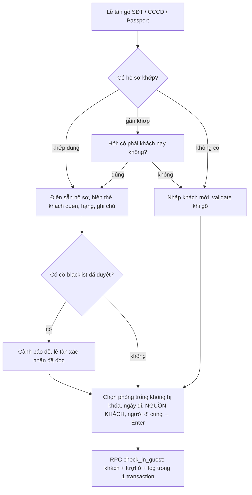

# 01 – Tổng quan và nghiệp vụ

Phiên bản 2 (21/10/2026): đã áp phản hồi của chủ đầu tư (CĐT) và bổ sung **quản lý cơ sở vật chất**, **báo cáo biểu đồ có so sánh cùng kỳ**. Danh sách thay đổi ở cuối file.

## 1. Bối cảnh

- Chuỗi 8 khách sạn, tổng 240 phòng (Boutique 31, Grand 43, Xavia 40, Eco 18, Ngô Mây 22, Aloha 28, Sun 38, Bãi Xếp 20), ước tính ~100 lượt check-in/ngày toàn chuỗi (~35.000 lượt/năm).
- Đã dùng ezCloud cho vận hành phòng, giá, OTA, thanh toán, giao ca. Hệ thống này **không thay thế** ezCloud.
- Giai đoạn 1: app độc lập, lễ tân nhập tay. Chưa đồng bộ ezCloud, chưa gửi Zalo/SMS tự động.
- Tài khoản ban đầu (CĐT chốt): 1 Chủ chuỗi, 2 Quản lý (phạm vi toàn chuỗi), 16 Lễ tân (2 người mỗi cơ sở). Sales, Kỹ thuật tạo khi có người.
- Không nhập dữ liệu khách cũ; Quản lý được nhập bù lượt ở trong quá khứ khi cần.

## 2. Phạm vi giai đoạn 1

| Trong phạm vi | Ngoài phạm vi (giai đoạn sau hoặc ezCloud) |
| --- | --- |
| Nhập tay khách + lượt ở tại quầy, **nguồn khách bắt buộc** | Đặt phòng, giá, đồng bộ OTA |
| Hồ sơ khách dùng chung 8 cơ sở, hạng thành viên | Folio, thanh toán, công nợ, giao ca |
| Tìm kiếm nhanh theo tên / email / SĐT / CCCD, hồ sơ 360° | Khai báo lưu trú chính thức (vẫn làm trên ASM) |
| Sales thêm khách tiềm năng, theo dõi khách mình phụ trách | Gửi Zalo ZNS / SMS tự động |
| Ghi chú, tag, blacklist, gộp hồ sơ trùng | Đồng bộ dữ liệu với ezCloud |
| **Cơ sở vật chất**: tài sản, sự cố, khóa phòng ngừng bán, bảo trì định kỳ, kiểm tra, hồ sơ pháp lý | Kho vật tư tiêu hao, mua sắm |
| **Báo cáo biểu đồ**: công suất, lượt đến, khách quay lại, nguồn khách, CSVC; so sánh cùng kỳ | Doanh thu tự động (cần ezCloud; tạm nhập tay theo tháng) |
| Bật/tắt module, phân quyền động bằng checkbox, nhật ký thao tác, PWA | Quét QR CCCD (module có sẵn, mặc định tắt) |

## 3. Thuật ngữ

| Thuật ngữ | Nghĩa | Tên trong code |
| --- | --- | --- |
| Cơ sở | Một khách sạn trong chuỗi | `branch` |
| Khách / hồ sơ khách | Một con người, duy nhất toàn chuỗi | `guest` |
| Khách tiềm năng | Hồ sơ chưa có lượt ở nào (thường do sales nhập) | `guest_stats.total_stays = 0` |
| Sales phụ trách | Sales được xem hồ sơ đầy đủ của khách | `guests.sales_owner_id` |
| Giấy tờ | CCCD hoặc Passport của khách | `guest_document` |
| Lượt ở | Một lần khách đến ở một cơ sở | `stay` |
| Nhập bù | Lượt ở nhập sau khi khách đã trả phòng | `stays.entry_mode = 'backdated'` |
| Nguồn khách | Kênh khách đến: vãng lai, OTA, đối tác, công ty... | `source_channels`, `partners` |
| Người đại diện / người đi cùng | Khách đứng tên lượt ở / khách ở chung | `stay_guests.is_primary` |
| Tài sản | Thiết bị, nội thất có mã, gắn với phòng hoặc khu vực | `asset` |
| Phiếu sự cố / sửa chữa | Một việc kỹ thuật cần xử lý | `work_order` |
| Khóa phòng | Phòng ngừng bán vì hỏng hóc, sửa chữa | `room_block` |
| Kỳ so sánh / cùng kỳ | Khoảng thời gian đối chiếu trong báo cáo | `compare_range` |
| Module / Quyền / Vai trò | Nhóm chức năng bật/tắt / hành động cụ thể / gói quyền mặc định | `module` / `permission` / `role` |

## 4. Người dùng và quyền mặc định (theo phản hồi CĐT)

| Việc | Lễ tân | Quản lý | Sales | Kỹ thuật | Chủ chuỗi |
| --- | --- | --- | --- | --- | --- |
| Check-in, sửa, trả phòng lượt ở | Cơ sở mình | Mọi cơ sở | Không | Không | Tất cả |
| Nhập bù lượt ở quá khứ | Không | Có | Không | Không | Có |
| Hủy lượt ở | Trong 6 giờ | Không giới hạn | Không | Không | Có |
| Tìm khách toàn chuỗi | Có | Có | Có | Không | Có |
| Xem hồ sơ 360° đầy đủ | Có (mọi khách) | Có | Chỉ khách mình phụ trách | Không | Có |
| Thêm hồ sơ khách | Có | Có | Có (không kèm lượt ở) | Không | Có |
| Sửa thông tin khách | Có, ghi log | Có | **Không** | Không | Có |
| Ghi chú, tag | Có | Có | Có | Không | Có |
| Blacklist | Đề xuất | Duyệt, gỡ | Đề xuất | Không | Có |
| Gộp hồ sơ trùng | Đề xuất | **Duyệt** | Đề xuất | Không | Có |
| Xuất Excel danh sách khách | Có (khách từng ở cơ sở mình, ≤ 500 dòng, CCCD che) | Có (≤ 5.000 dòng, CCCD che) | **Không** | Không | Có (được xuất CCCD đầy đủ) |
| Cài đặt cơ sở, phòng, tài khoản, vai trò, module | Không | **Có** (bắt buộc MFA) | Không | Không | Có |
| Nhật ký thao tác | Không | Toàn chuỗi | Không | Không | Có |
| Báo sự cố, khóa phòng ngừng bán | Có | Có | Không | Có | Có |
| Xử lý phiếu sự cố | Không | Có | Không | Phiếu được giao | Có |
| Nghiệm thu phiếu, quản lý tài sản, bảo trì định kỳ, hồ sơ pháp lý | Không (xem hồ sơ) | Có | Không | Xem | Có |
| Báo cáo, biểu đồ | Không | Toàn chuỗi | Không | Không | Có |

Vai trò chỉ là gói quyền mặc định; mọi ô đổi được bằng checkbox (`04-phan-quyen-dong.md`). Quản lý có gần đủ quyền của Chủ chuỗi **trừ** xuất CCCD đầy đủ; nhờ vậy quản lý không sửa được tài khoản Chủ chuỗi.

## 5. Luồng nghiệp vụ

### 5.1 Check-in (lễ tân, mục tiêu < 30 giây với khách mới, < 10 giây với khách cũ)

Quy tắc:

- Cơ sở mặc định = cơ sở đang chọn; giờ đến = hiện tại; ngày đi = 12:00 hôm sau.
- Nhận phòng trước giờ cắt đêm (mặc định 06:00, cấu hình theo cơ sở) được tính là đêm hôm trước.
- Một phòng chỉ có tối đa 1 lượt **Đang ở**; phòng đang **khóa ngừng bán** không check-in được.
- **Nguồn khách bắt buộc**; kênh "Đối tác tour / đại lý" và "Khách công ty" bắt buộc chọn tên đối tác từ danh sách do quản lý cấu hình.
- Gần khớp = cùng họ tên không dấu + cùng ngày sinh, hoặc CCCD lệch đúng 1 chữ số, hoặc cùng SĐT khác giấy tờ.

### 5.2 Nhập bù lượt ở quá khứ (Quản lý)

- Giờ nhận phòng sớm hơn hiện tại quá 12 giờ → hệ thống coi là nhập bù, yêu cầu quyền `stay.create_past`.
- Bắt buộc giờ trả phòng thực tế; lượt ở lưu thẳng trạng thái **Đã trả phòng**, đánh dấu "nhập bù" trong lịch sử và nhật ký.
- Không được trùng thời gian với lượt ở khác cùng phòng. Không cảnh báo blacklist (khách đã đi).
- Lượt nhập bù được tính vào số lượt ở, hạng thành viên, báo cáo như lượt thường.

### 5.3 Sửa / gia hạn / đổi phòng / trả phòng / hủy

| Thao tác | Ai | Xử lý | Số lượt ở |
| --- | --- | --- | --- |
| Sửa lượt ở (sai phòng, sai ngày) | Lễ tân, quản lý | Update + log cũ/mới | Giữ nguyên |
| Sửa thông tin khách | Lễ tân, quản lý | Update; trùng SĐT/giấy tờ với hồ sơ khác → chặn, gợi ý gộp | Giữ nguyên |
| Gia hạn / đổi phòng | Lễ tân, quản lý | Update cùng lượt ở | Giữ nguyên |
| Trả phòng | Lễ tân, quản lý | `status = checked_out`, ghi giờ thực tế | Giữ nguyên |
| Hủy (nhập nhầm, khách không ở) | Lễ tân trong **6 giờ**; sau 6 giờ cần quản lý | `status = cancelled`, bắt buộc lý do | Giảm 1 |
| Khách quay lại sau khi đã trả | Lễ tân | Lượt ở mới | Tăng 1 |

Số lượt ở không lưu cứng: luôn đếm từ `stays` có `status <> 'cancelled'`. Thời hạn 6 giờ là tham số `stay.self_cancel_hours`.

### 5.4 Tìm kiếm và hồ sơ 360°

- Một ô tìm kiếm toàn cục (`/` hoặc `Ctrl+K`), tự nhận loại từ khoá: SĐT, CCCD, Passport, email, họ tên (không dấu, theo từng từ).
- Kết quả: tối đa 20 dòng, CCCD che một phần, kèm hạng, số lượt ở, cơ sở gần nhất, cờ.
- Hồ sơ 360°: thông tin đầy đủ, chỉ số, hạng (còn bao nhiêu đêm lên hạng), lịch sử lượt ở có nguồn khách, người đi cùng, ghi chú, tag, consent, cờ, sales phụ trách. Mỗi lần mở bản đầy đủ được ghi audit.
- Sales mở hồ sơ khách **không** do mình phụ trách → thấy bản tóm tắt (CCCD che, không có ngày sinh, địa chỉ chi tiết); quản lý có thể giao khách cho sales.

### 5.5 Sales thêm khách

- Sales nhập khách tiềm năng (khách công ty, khách hỏi giá): cần ít nhất SĐT hoặc giấy tờ.
- SĐT/giấy tờ đã tồn tại → hệ thống báo "Khách đã có trong hệ thống", **không** tạo trùng và **không** sửa hồ sơ cũ.
- Khách do sales tạo có sales đó là người phụ trách. Khi khách đến ở, lễ tân check-in bình thường, hồ sơ vẫn giữ sales phụ trách.

### 5.6 Hạng thành viên và giảm giá

Hạng và mức giảm giá **cấu hình động** trong `/settings/loyalty` (quyền `loyalty.configure`), không cần sửa code:

| Cấu hình | Ý nghĩa | Giá trị mẫu (chờ CĐT chốt) |
| --- | --- | --- |
| Danh sách hạng | Tên, ngưỡng, % giảm giá, quyền lợi khác; thêm/ẩn hạng tuỳ ý | Thành viên 0 · **Đồng ≥ 2 · Bạc ≥ 5 · Vàng ≥ 10** |
| % giảm giá | Mức giảm cho mỗi hạng | 0% · 3% · 5% · 10% |
| Tính theo | Số **lần lưu trú** hoặc số **đêm** | Số lần lưu trú |
| Cửa sổ thời gian | Chỉ tính N tháng gần nhất; 0 = trọn đời (không xuống hạng) | 24 tháng |
| Tính lượt hiện tại | Lượt đang check-in có được tính để hưởng giảm giá ngay không | Không (lên hạng áp từ lần sau) |

Luồng tại quầy:

1. Lễ tân gõ SĐT/CCCD của khách đã có → thẻ khách hiện **hạng hiện tại, % giảm giá áp cho lượt này**, và "còn N lần nữa lên hạng X".
2. Lưu check-in → hệ thống lưu hạng + % giảm vào lượt ở (ảnh chụp, đổi cấu hình sau không ảnh hưởng). Nếu lượt này làm khách vượt ngưỡng → thông báo "Khách vừa lên hạng Bạc, giảm 5% từ lần sau" và ghi lịch sử lên hạng.
3. Lễ tân áp giảm giá trên ezCloud rồi tích **"Đã áp giảm giá"** trên lượt ở (để chủ chuỗi kiểm tra việc áp ưu đãi).
4. Quản lý (quyền `loyalty.override`) gán hạng thủ công cho khách đặc biệt, có lý do và hạn dùng; hạng gán tay là mức sàn.

CĐT trước đó chốt "Bạc 5 đêm, Vàng 20 đêm, 24 tháng"; yêu cầu mới tính theo **số lần** và thêm hạng **Đồng** → cần CĐT chốt lại ngưỡng và % giảm (đổi trong cấu hình, không cần sửa code).

### 5.7 Gộp hồ sơ trùng

1. Job hằng đêm đánh dấu cặp nghi trùng → `merge_requests` (`source = system`).
2. Lễ tân, sales hoặc quản lý đề xuất gộp từ hồ sơ (`source = user`).
3. **Quản lý** xem hai hồ sơ cạnh nhau, chọn giá trị giữ cho từng trường, bấm Gộp (bắt buộc MFA).
4. Lượt ở, ghi chú, tag, cờ, giấy tờ dồn về hồ sơ giữ lại; hồ sơ kia ẩn khỏi tìm kiếm, link cũ tự chuyển hướng.

### 5.8 Blacklist

1. Lễ tân hoặc sales đề xuất: chọn loại, lý do khách quan, ảnh/biên bản → cờ vàng **Cần lưu ý**.
2. **Quản lý** duyệt → cờ đỏ ở mọi cơ sở, kèm lý do + cơ sở ghi nhận.
3. Check-in khách có cờ đỏ vẫn được, nhưng phải xác nhận đã đọc; xác nhận được ghi log.
4. Gỡ cờ: quản lý hoặc chủ chuỗi, bắt buộc lý do.

### 5.9 Cơ sở vật chất

Chi tiết ở `12-co-so-vat-chat.md`. Tóm tắt luồng chính:

1. Nhân viên báo sự cố trên điện thoại (phòng/khu vực, tài sản, ảnh, ưu tiên), tích "Phòng ngừng bán" nếu cần → phòng bị khóa, không check-in được.
2. Quản lý giao cho kỹ thuật hoặc thợ ngoài → kỹ thuật xử lý, ghi kết quả + chi phí → quản lý nghiệm thu → phòng tự mở bán.
3. Bảo trì định kỳ tự sinh phiếu trước hạn; kiểm tra theo checklist tự sinh phiếu cho mục không đạt.
4. Hồ sơ pháp lý, kiểm định, bảo hành được nhắc trước khi hết hạn.

### 5.10 Báo cáo và so sánh cùng kỳ

Chi tiết ở `13-bao-cao-thong-ke.md`. Báo cáo công suất, đêm phòng, lượt đến, khách mới/quay lại, khách luân chuyển cơ sở, nguồn khách, quốc tịch, chỉ số CSVC; so sánh với cùng kỳ năm trước (theo ngày hoặc khớp thứ), kỳ liền trước. Năm đầu chưa có dữ liệu năm trước → nhập số liệu nền theo tháng từ báo cáo ezCloud.

### 5.11 Bật/tắt module và phân quyền

Ma trận module × cơ sở (Tắt / Chỉ xem / Bật), ma trận vai trò × quyền dạng checkbox, ghi đè theo từng người. Chi tiết: `04-phan-quyen-dong.md`.

## 6. Danh mục module

| Nhóm | Key | Tên | Phụ thuộc | Mặc định | Xây ở GĐ1 |
| --- | --- | --- | --- | --- | --- |
| Lõi | `core` | Cơ sở, tài khoản, check-in, nguồn khách, tìm kiếm, hồ sơ, ghi chú, nhật ký, xuất Excel | — | Luôn bật | ✓ |
| Khách hàng | `companions` | Người đi cùng | — | Bật | ✓ |
| Khách hàng | `international` | Khách quốc tế (Passport) | — | Bật | ✓ |
| Khách hàng | `merge` | Gộp hồ sơ trùng | — | Bật | ✓ |
| Khách hàng | `blacklist` | Blacklist toàn chuỗi | — | Bật | ✓ |
| Khách hàng | `loyalty` | Hạng thành viên, giảm giá (cấu hình động) | — | Bật | ✓ |
| Khách hàng | `consent` | Đồng ý nhận tin | — | Tắt | ✓ |
| Khách hàng | `qr_cccd` | Quét QR CCCD | — | Tắt | ✓ |
| Khách hàng | `birthday`, `vouchers` | Sinh nhật, voucher | `consent` | Tắt | Sắp có |
| Đối tác | `partners`, `partner_contracts`, `group_bookings`, `commissions` | Đối tác mở rộng, hợp đồng giá, khách đoàn, hoa hồng | `partners` | Tắt | Sắp có |
| Cơ sở vật chất | `facilities` | Tài sản, vị trí, nhà cung cấp | — | Bật | ✓ |
| Cơ sở vật chất | `work_orders` | Sự cố, sửa chữa, khóa phòng | `facilities` | Bật | ✓ |
| Cơ sở vật chất | `preventive` | Bảo trì định kỳ | `facilities`, `work_orders` | Bật | ✓ |
| Cơ sở vật chất | `inspections` | Kiểm tra theo checklist | `work_orders` | Tắt | ✓ |
| Cơ sở vật chất | `compliance` | Hồ sơ pháp lý, kiểm định | `facilities` | Bật | ✓ |
| Quản lý chuỗi | `reports` | Báo cáo, biểu đồ, so sánh cùng kỳ | — | Bật | ✓ |
| Quản lý chuỗi | `revenue_input` | Nhập doanh thu tháng → ADR, RevPAR | `reports` | Tắt | ✓ |
| Quản lý chuỗi | `feedback`, `asm_export` | Phản hồi khách, xuất khai báo lưu trú | — | Tắt | Sắp có |

Danh sách đối tác tối thiểu (tên, loại, liên hệ) thuộc **lõi** vì nguồn khách cần nó; module `partners` sau này mở rộng thêm hợp đồng, hoa hồng trên cùng bảng.

## 7. Thay đổi so với phiên bản 1

| # | Thay đổi | Nguồn |
| --- | --- | --- |
| 1 | Lễ tân xem hồ sơ đầy đủ toàn chuỗi, được xuất Excel (giới hạn cơ sở + số dòng, CCCD che) | CĐT |
| 2 | Sales chỉ xem đầy đủ khách mình phụ trách; được thêm khách, ghi chú, đề xuất blacklist/gộp; không sửa, không xuất | CĐT |
| 3 | Quản lý (2 người, toàn chuỗi): duyệt gộp + blacklist, cài đặt tài khoản/module/vai trò, xem nhật ký toàn chuỗi | CĐT |
| 4 | Lễ tân tự hủy lượt ở trong 6 giờ (trước là 24 giờ) | CĐT |
| 5 | Hạng: 24 tháng, Bạc 5 đêm, Vàng 20 đêm (thay bằng cấu hình động ở dòng 12) | CĐT |
| 6 | Nguồn khách bắt buộc ngay từ GĐ1; thêm danh mục kênh + danh sách đối tác | CĐT |
| 7 | Không nhập dữ liệu cũ; quản lý nhập bù lượt ở quá khứ | CĐT |
| 8 | Thêm vai trò Kỹ thuật, module Cơ sở vật chất (5 module) | CĐT yêu cầu thêm |
| 9 | Thêm module Báo cáo + so sánh cùng kỳ, số liệu nền tháng, nhập doanh thu tháng | CĐT yêu cầu thêm |
| 10 | Quản lý không sửa được tài khoản đang có quyền mà quản lý không có (bảo vệ tài khoản Chủ chuỗi) | Rà soát bảo mật |
| 11 | Module Blacklist, Hạng thành viên chuyển mặc định Bật (đã có người duyệt và tham số) | Hệ quả quyết định CĐT |
| 12 | Hạng thành viên động: danh sách hạng (Đồng, Bạc, Vàng...), ngưỡng theo số lần hoặc số đêm, % giảm giá, tự nâng hạng khi check-in, gán hạng tay | Yêu cầu bổ sung 21/10 |
| 13 | Gán quyền từng nhân sự bằng tích chọn (vai trò chỉ là bộ tích sẵn, sao chép quyền từ người khác) | Yêu cầu bổ sung 21/10 |
