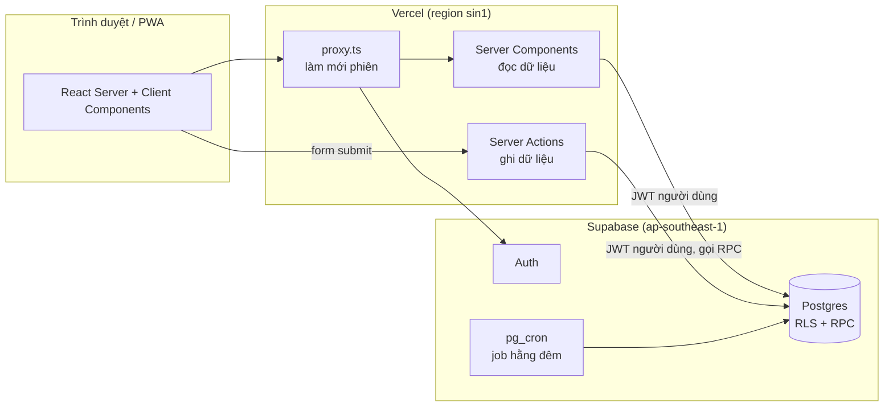
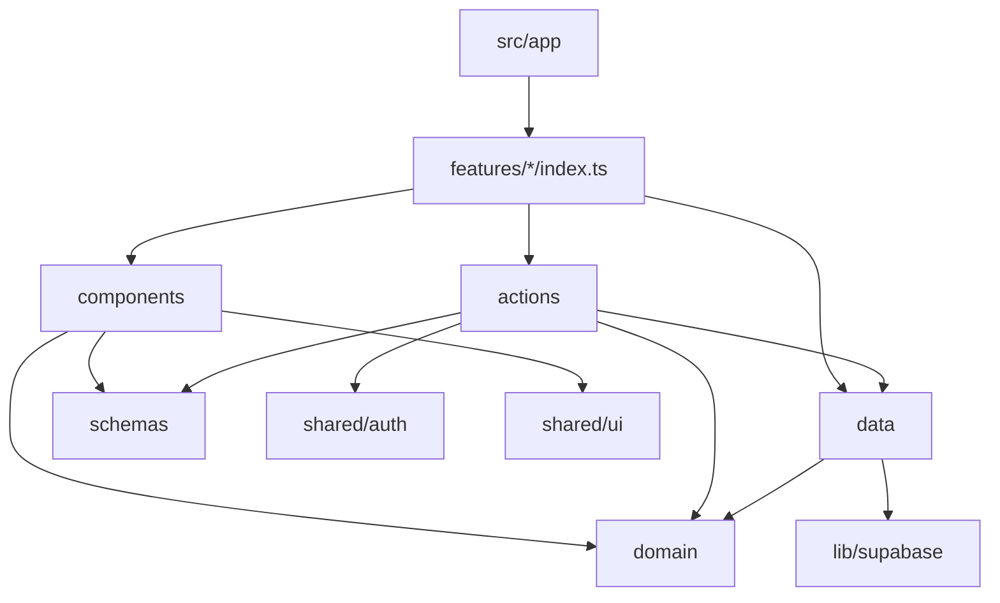

# 02 – Kiến trúc

## 1. Tổng thể



Quyết định chính:

| Quyết định | Lý do |
| --- | --- |
| Next.js App Router, đọc bằng Server Components | Không lộ query ra client, ít JavaScript, nhanh trên máy quầy cấu hình thấp |
| Ghi bằng Server Actions → RPC Postgres | Một transaction cho mỗi nghiệp vụ, bất biến nằm trong DB |
| Supabase RLS là lớp phân quyền cuối | Lỗi ở tầng app không làm lộ dữ liệu cơ sở khác |
| Không dùng API REST riêng | Bớt một tầng cần bảo trì; Server Actions đã có CSRF protection và type-safe |
| Vercel `sin1` + Supabase Singapore | Đặt hai bên cùng vùng để giảm độ trễ mỗi query (khách ở Việt Nam) |
| Feature-based (vertical slice) | Thêm module mới = thêm một thư mục, không chạm lõi |

## 2. Cấu trúc thư mục

```text
.
├── AGENTS.md
├── biome.json
├── next.config.ts
├── vercel.json                       # regions: ["sin1"]
├── public/
│   ├── icons/                        # icon PWA 192, 512, maskable
│   └── sw.js                         # service worker (xem 07)
├── supabase/
│   ├── config.toml
│   ├── migrations/                   # SQL theo thứ tự thời gian (xem 03, 04)
│   ├── seed.sql                      # dữ liệu mẫu cho local
│   └── tests/                        # pgTAP: RLS, quyền, RPC
├── e2e/                              # Playwright
└── src/
    ├── proxy.ts                      # Next 16: làm mới phiên Supabase, chặn route chưa đăng nhập
    ├── app/                          # CHỈ routing + layout
    │   ├── manifest.ts               # Web App Manifest
    │   ├── (auth)/login/page.tsx
    │   ├── (app)/layout.tsx          # shell: sidebar, chọn cơ sở, ô tìm kiếm toàn cục
    │   ├── (app)/check-in/page.tsx
    │   ├── (app)/stays/page.tsx      # khách đang ở hôm nay
    │   ├── (app)/guests/page.tsx     # danh sách khách
    │   ├── (app)/guests/[id]/page.tsx# hồ sơ 360°
    │   ├── (app)/approvals/page.tsx  # chờ duyệt gộp / blacklist
    │   ├── (app)/audit/page.tsx
    │   ├── (app)/facilities/         # báo sự cố, phiếu, tài sản, bảo trì, kiểm tra, hồ sơ, cảnh báo (xem 12)
    │   ├── (app)/reports/            # tổng quan, CSVC, báo cáo tháng (xem 13)
    │   ├── api/export/guests/route.ts   # xuất xlsx (server)
    │   └── (app)/settings/
    │       ├── branches/page.tsx
    │       ├── rooms/page.tsx
    │       ├── users/page.tsx
    │       ├── roles/page.tsx        # ma trận vai trò × quyền (checkbox)
    │       ├── modules/page.tsx      # ma trận module × cơ sở
    │       ├── sources/page.tsx      # kênh nguồn khách, danh sách đối tác
    │       └── parameters/page.tsx   # tham số: hạng, giờ tự hủy, giới hạn xuất, ngày chạy thật, SLA phiếu
    ├── features/
    │   ├── check-in/
    │   ├── stays/
    │   ├── guests/                   # hồ sơ, ghi chú, tag, consent
    │   ├── search/
    │   ├── merge/
    │   ├── blacklist/
    │   ├── audit/
    │   ├── sources/                  # kênh nguồn khách, đối tác
    │   ├── facilities/               # tài sản, vị trí, nhà cung cấp, hồ sơ pháp lý
    │   ├── work-orders/              # phiếu sự cố, khóa phòng, bảo trì định kỳ, kiểm tra
    │   ├── reports/                  # báo cáo, biểu đồ, so sánh cùng kỳ
    │   └── admin/                    # branches, rooms, users, roles, modules, parameters
    ├── shared/
    │   ├── auth/                     # session, requirePermission, permission-keys.ts
    │   ├── db/types.ts               # sinh tự động, không sửa tay
    │   ├── errors.ts                 # mã lỗi + ActionResult
    │   ├── i18n/vi.ts                # câu chữ tiếng Việt
    │   ├── lib/                      # date, format, utils thuần
    │   └── ui/                       # shadcn components + component dùng chung
    └── lib/supabase/
        ├── server.ts                 # client theo phiên, dùng trong RSC + Server Actions
        ├── browser.ts                # client trình duyệt (chỉ dùng cho auth UI)
        └── admin.ts                  # secret key, import 'server-only', chỉ quản trị tài khoản
```

### Bên trong một feature

```text
src/features/guests/
├── index.ts            # public API: chỉ export những gì feature khác/route được dùng
├── domain/             # TS thuần: kiểu dữ liệu, quy tắc, chuẩn hoá, tính toán
│   ├── types.ts
│   ├── normalize.ts    # chuẩn hoá tên, SĐT, email
│   ├── cccd.ts         # validate CCCD
│   └── tier.ts         # tính hạng từ số đêm
├── schemas.ts          # Zod: dùng chung cho form và Server Action
├── data/
│   ├── queries.ts      # đọc (server-only): select, gọi RPC đọc
│   └── mappers.ts      # row DB → kiểu domain
├── actions.ts          # 'use server': ghi
└── components/         # UI của feature
    ├── guest-profile.tsx
    └── note-form.tsx
```

## 3. Quy tắc phụ thuộc



| Tầng | Được import | Cấm import |
| --- | --- | --- |
| `app/**` | `features/*/index.ts`, `shared/ui`, `shared/auth` | `features/*/data`, `lib/supabase` |
| `features/x/domain` | `shared/lib` | `next`, `react`, `@supabase/*`, feature khác |
| `features/x/data` | `domain`, `lib/supabase/server`, `shared/db` | `components`, `react` |
| `features/x/actions` | `schemas`, `data`, `domain`, `shared/auth`, `shared/errors` | `components` |
| `features/x/components` | `schemas`, `domain`, `actions` (để gọi), `shared/ui` | `data`, `lib/supabase` |
| `features/x` → `features/y` | chỉ `features/y/index.ts` | mọi file khác của `y` |

Biome không kiểm tra ranh giới tầng, nên dùng `dependency-cruiser` (chạy trong `pnpm lint` và CI) để chặn import sai tầng theo đúng bảng trên.

## 4. Mã nền tảng

### 4.1 Supabase client

```ts
// src/lib/supabase/server.ts
import 'server-only';
import { cookies } from 'next/headers';
import { createServerClient } from '@supabase/ssr';
import type { Database } from '@/shared/db/types';

export async function createClient() {
  const cookieStore = await cookies();
  return createServerClient<Database>(
    process.env.NEXT_PUBLIC_SUPABASE_URL!,
    process.env.NEXT_PUBLIC_SUPABASE_PUBLISHABLE_KEY!,
    {
      cookies: {
        getAll: () => cookieStore.getAll(),
        setAll: (list) => {
          try {
            list.forEach(({ name, value, options }) => cookieStore.set(name, value, options));
          } catch {
            // Server Component không ghi được cookie; proxy.ts lo việc làm mới phiên.
          }
        },
      },
    },
  );
}
```

```ts
// src/lib/supabase/admin.ts — CHỈ dùng cho mời/khóa tài khoản
import 'server-only';
import { createClient } from '@supabase/supabase-js';
import type { Database } from '@/shared/db/types';

export const supabaseAdmin = () =>
  createClient<Database>(process.env.NEXT_PUBLIC_SUPABASE_URL!, process.env.SUPABASE_SECRET_KEY!, {
    auth: { persistSession: false, autoRefreshToken: false },
  });
```

### 4.2 proxy.ts (Next.js 16)

```ts
// src/proxy.ts
import { NextResponse, type NextRequest } from 'next/server';
import { createServerClient } from '@supabase/ssr';

const PUBLIC_PATHS = ['/login', '/offline'];

export async function proxy(request: NextRequest) {
  let response = NextResponse.next({ request });
  const supabase = createServerClient(
    process.env.NEXT_PUBLIC_SUPABASE_URL!,
    process.env.NEXT_PUBLIC_SUPABASE_PUBLISHABLE_KEY!,
    {
      cookies: {
        getAll: () => request.cookies.getAll(),
        setAll: (list) => {
          list.forEach(({ name, value }) => request.cookies.set(name, value));
          response = NextResponse.next({ request });
          list.forEach(({ name, value, options }) => response.cookies.set(name, value, options));
        },
      },
    },
  );

  const { data } = await supabase.auth.getClaims();
  const isPublic = PUBLIC_PATHS.some((p) => request.nextUrl.pathname.startsWith(p));
  if (!data?.claims && !isPublic) {
    return NextResponse.redirect(new URL('/login', request.url));
  }
  return response;
}

export const config = {
  matcher: ['/((?!_next/static|_next/image|icons|sw.js|manifest.webmanifest|favicon.ico).*)'],
};
```

`proxy.ts` chỉ kiểm tra **đã đăng nhập**. Kiểm tra **quyền** luôn làm trong Server Component / Server Action / RPC.

### 4.3 Kết quả Server Action

```ts
// src/shared/errors.ts
import { z } from 'zod';
import { messages } from './i18n/vi';

export type ErrorCode =
  | 'UNAUTHENTICATED' | 'FORBIDDEN' | 'MODULE_DISABLED' | 'VALIDATION'
  | 'DUPLICATE_DOCUMENT' | 'DUPLICATE_PHONE' | 'ROOM_OCCUPIED' | 'BLACKLIST_ACK_REQUIRED'
  | 'RATE_LIMITED' | 'NOT_FOUND' | 'CONFLICT' | 'UNKNOWN';

export type ActionResult<T> =
  | { ok: true; data: T }
  | { ok: false; error: { code: ErrorCode; message: string; fieldErrors?: Record<string, string[]> } };

// Postgres RAISE EXCEPTION dùng ERRCODE riêng → map về ErrorCode (bảng đầy đủ ở 06)
const PG_CODE_MAP: Record<string, ErrorCode> = {
  P0401: 'UNAUTHENTICATED', P0403: 'FORBIDDEN', P0404: 'NOT_FOUND', P0409: 'CONFLICT',
  P0410: 'DUPLICATE_DOCUMENT', P0411: 'DUPLICATE_PHONE', P0412: 'ROOM_OCCUPIED',
  P0422: 'VALIDATION', P0423: 'MODULE_DISABLED', P0428: 'BLACKLIST_ACK_REQUIRED', P0429: 'RATE_LIMITED',
  '23505': 'CONFLICT', '23514': 'VALIDATION',
};

const isErrorCode = (c: string): c is ErrorCode => c in messages.errors;

export const ok = <T>(data: T): ActionResult<T> => ({ ok: true, data });

// Nhận ErrorCode của app hoặc SQLSTATE của Postgres
export function fail(code: string | undefined, fieldErrors?: Record<string, string[]>): ActionResult<never> {
  const c: ErrorCode = code && isErrorCode(code) ? code : (code && PG_CODE_MAP[code]) || 'UNKNOWN';
  return { ok: false, error: { code: c, message: messages.errors[c], fieldErrors } };
}

export const toFieldErrors = (e: z.ZodError) => z.flattenError(e).fieldErrors as Record<string, string[]>;
```

`messages.errors` trong `src/shared/i18n/vi.ts` là object `Record<ErrorCode, string>` chứa câu thông báo tiếng Việt (bảng ở mục 1 của file 06). Lỗi `UNKNOWN` được gửi lên Sentry kèm SQLSTATE, không kèm payload.

### 4.4 Khuôn mẫu một Server Action

```ts
// src/features/check-in/actions.ts
'use server';
import { revalidatePath } from 'next/cache';
import { createClient } from '@/lib/supabase/server';
import { requirePermission } from '@/shared/auth';
import { fail, ok, toFieldErrors } from '@/shared/errors';
import { checkInSchema } from './schemas';
import { toRpcPayload } from './domain/payload';

export async function checkInGuest(input: unknown) {
  const parsed = checkInSchema.safeParse(input);                         // 1. validate
  if (!parsed.success) return fail('VALIDATION', toFieldErrors(parsed.error));

  const auth = await requirePermission('stay.create', parsed.data.branchId); // 2. quyền
  if (!auth.ok) return auth;

  const supabase = await createClient();
  const { data, error } = await supabase.rpc('check_in_guest', {          // 3. nghiệp vụ trong DB
    p_payload: toRpcPayload(parsed.data),
  });
  if (error) return fail(error.code);                                     // 4. map lỗi

  revalidatePath('/stays');                                               // 5. làm mới UI
  return ok(data);
}
```

Mọi action đều theo đúng 5 bước này, theo đúng thứ tự.

## 5. Luồng một request đọc (ví dụ hồ sơ 360°)

1. `app/(app)/guests/[id]/page.tsx` → `await params` → gọi `getGuestProfile(id)` từ `features/guests`.
2. `getGuestProfile` (server-only) gọi RPC `get_guest_profile(p_guest_id)` → trả về một JSON đủ cho cả trang (một round-trip).
3. RPC tự kiểm tra `guest.view_full`, ghi audit, che CCCD nếu người xem chỉ có `guest.view_summary`.
4. Page render Server Component; phần tương tác (thêm ghi chú) là Client Component gọi Server Action.

## 6. Mở rộng về sau

| Nhu cầu | Cách làm không phá kiến trúc |
| --- | --- |
| Module mới (ví dụ `partners`) | Thêm `features/partners/`, migration bảng + quyền + policy, dòng trong `modules` |
| Đồng bộ ezCloud | Thêm `features/integrations/ezcloud/` + Vercel Cron hoặc Supabase Edge Function; `stays.source = 'ezcloud_import'`, `stays.external_ref` |
| Gửi Zalo ZNS | Bảng `outbox_messages` + Edge Function xử lý hàng đợi; không gửi trực tiếp từ request |
| Nhiều chuỗi (SaaS) | Thêm cột `org_id` vào mọi bảng + điều kiện trong `private.has_perm`; giữ nguyên tầng app |
