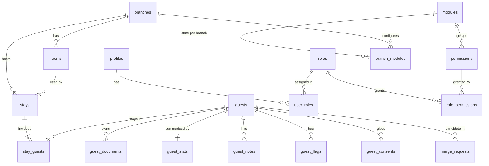

# 03 – Database (Supabase Postgres)

## 1. Nguyên tắc

- Mọi bảng nằm trong schema `public` và **bật RLS** (policy ở `05-bao-mat.md`). Hàm nội bộ nằm trong schema `private`, schema này **không** được expose qua Data API.
- Khóa chính `uuid` (`gen_random_uuid()`), trừ `audit_logs` dùng `bigint identity` cho tốc độ ghi.
- Thời gian lưu `timestamptz`; quy đổi giờ Việt Nam bằng `at time zone 'Asia/Ho_Chi_Minh'`.
- Bất biến nghiệp vụ đặt bằng `CHECK`, `UNIQUE`, khóa ngoại phức hợp. Ứng dụng validate trước cho UX, DB chặn lần cuối.
- Số liệu dẫn xuất (`nights`, `guest_stats`) do trigger tính, ứng dụng không ghi.
- Không xoá cứng khách: gộp thì dùng `merged_into`, hủy lượt ở thì dùng `status = 'cancelled'`.

## 2. Sơ đồ quan hệ



Bảng phân quyền (`modules`, `permissions`, `roles`, `role_permissions`, `user_roles`, `user_permission_overrides`, `user_effective_permissions`, `branch_modules`) nằm ở `04-phan-quyen-dong.md`.

## 3. Thứ tự migration

| File | Nội dung | Ở tài liệu |
| --- | --- | --- |
| `20261101000001_extensions_private.sql` | Extension, schema `private`, enum, hàm tiện ích | 03 |
| `20261101000002_org.sql` | `branches`, `rooms`, `profiles`, `app_settings`, đơn vị hành chính | 03 |
| `20261101000003_guests.sql` | `guests`, `guest_documents`, `guest_stats` | 03 |
| `20261101000004_stays.sql` | `stays`, `stay_guests`, trigger tính đêm và thống kê | 03 |
| `20261101000005_guest_extras.sql` | `guest_notes`, `guest_flags`, `guest_consents`, `merge_requests` | 03 |
| `20261101000006_audit.sql` | `audit_logs`, trigger audit | 03 |
| `20261101000007_permissions.sql` | Module, quyền, vai trò, hàm `has_perm`, `assert_aal2` | 04 |
| `20261101000008_rls.sql` | Bật RLS + toàn bộ policy | 05 |
| `20261101000009_rpc.sql` | RPC nghiệp vụ | 06 |
| `20261101000010_catalog_seed.sql` | Danh mục module, quyền, vai trò mặc định | 04 |
| `20261101000011_cron.sql` | Job hằng đêm (pg_cron) | 06 |
| `20261101000012_facilities.sql` | Cơ sở vật chất: tài sản, sự cố, bảo trì định kỳ, kiểm tra, hồ sơ pháp lý | 12 |
| `20261101000013_reports.sql` | Hàm báo cáo, so sánh cùng kỳ, số liệu nền, doanh thu tháng | 13 |
| `20261101000054_confirm_room_cleaned.sql` | Thêm `cleaned_at` vào `stays`, RPC `confirm_room_cleaned` cho phép lễ tân báo sạch phòng nhanh | 03, 06 |
| `20261101000055_manage_rooms_rpc.sql` | Cấp quyền `settings.rooms` cho Quản lý cơ sở + 5 RPC CRUD/ngừng kinh doanh/xóa phòng | 04, 12 |
| `20261101000056_vietnam_provinces_and_guest_address.sql` | Nạp 34 tỉnh/thành phố 2025 sau sáp nhập vào `admin_provinces` | 03 |
| `20261101000057_grant_prospect_perms_to_receptionist.sql` | Cấp đủ 6 quyền `prospect.*` cho vai trò `receptionist` và rebuild quyền | 04 |

## 4. SQL

### 4.1 Extension, schema private, enum, tiện ích

```sql
-- 20261101000001_extensions_private.sql
create extension if not exists pg_trgm  with schema extensions;
create extension if not exists unaccent with schema extensions;
create extension if not exists fuzzystrmatch with schema extensions;   -- levenshtein cho CCCD lệch 1 số
create extension if not exists pg_cron;                                -- job hằng đêm (bật trong Dashboard → Integrations nếu cần)

create schema if not exists private;
revoke all on schema private from public, anon;
grant usage on schema private to authenticated;   -- policy RLS cần gọi hàm private
-- Hàm tạo sau này trong private mặc định KHÔNG ai được gọi; cấp quyền từng hàm khi cần
alter default privileges in schema private revoke execute on functions from public;
-- RPC public: không cho anon gọi; cấp cho authenticated từng hàm (xem 06)
alter default privileges in schema public revoke execute on functions from public, anon;

create type public.gender        as enum ('male', 'female', 'other');
create type public.doc_type      as enum ('cccd', 'passport');
create type public.stay_status   as enum ('in_house', 'checked_out', 'cancelled');
create type public.entry_mode    as enum ('live', 'backdated', 'import');   -- nhập tại quầy / nhập bù quá khứ / nhập từ hệ thống khác
create type public.note_kind     as enum ('general', 'preference', 'sales');
create type public.flag_type     as enum ('blacklist', 'attention');
create type public.flag_status   as enum ('proposed', 'approved', 'rejected', 'removed');
create type public.merge_status  as enum ('pending', 'approved', 'rejected');
create type public.module_state  as enum ('off', 'readonly', 'on');
create type public.perm_effect   as enum ('grant', 'deny');
create type public.perm_kind     as enum ('view', 'write');

-- Chuẩn hoá chuỗi để tìm kiếm: bỏ dấu, chữ thường, đ → d, gộp khoảng trắng
create or replace function private.normalize_search(p text)
returns text language sql immutable parallel safe strict
set search_path = ''
as $$
  select translate(
           lower(extensions.unaccent('extensions.unaccent'::regdictionary,
                 regexp_replace(btrim(p), '\s+', ' ', 'g'))),
           'đ', 'd');
$$;

create or replace function private.set_updated_at()
returns trigger language plpgsql set search_path = '' as $$
begin
  new.updated_at := now();
  return new;
end $$;
```

### 4.2 Tổ chức: cơ sở, phòng, nhân viên, cài đặt

```sql
-- 20261101000002_org.sql
create table public.branches (
  id                    uuid primary key default gen_random_uuid(),
  code                  text not null unique check (code ~ '^[A-Z0-9_]{2,10}$'),
  name                  text not null check (char_length(name) between 2 and 120),
  address               text,
  phone                 text,
  google_review_url     text,
  night_cutoff          time not null default '06:00',   -- nhận phòng trước giờ này = đêm hôm trước
  default_checkout_time time not null default '12:00',
  idle_logout_minutes   smallint not null default 15 check (idle_logout_minutes between 5 and 240),
  is_active             boolean not null default true,
  created_at            timestamptz not null default now(),
  updated_at            timestamptz not null default now()
);

create table public.rooms (
  id         uuid primary key default gen_random_uuid(),
  branch_id  uuid not null references public.branches(id) on delete restrict,
  number     text not null check (char_length(number) between 1 and 10),
  floor      smallint,
  room_type  text,
  opened_on  date,                     -- ngày bắt đầu đưa vào kinh doanh (null = có từ đầu); dùng tính công suất lịch sử
  closed_on  date,                     -- ngày ngừng kinh doanh vĩnh viễn
  is_active  boolean not null default true,
  created_at timestamptz not null default now(),
  unique (branch_id, number),
  unique (id, branch_id),              -- để stays dùng khóa ngoại phức hợp
  check (closed_on is null or opened_on is null or closed_on > opened_on)
);

-- Kênh nguồn khách: danh mục do quản lý cấu hình, không hardcode enum
create table public.source_channels (
  id               uuid primary key default gen_random_uuid(),
  code             text not null unique check (code ~ '^[a-z0-9_]{2,30}$'),
  name             text not null,
  kind             text not null check (kind in ('direct', 'ota', 'partner', 'corporate', 'other')),
  requires_partner boolean not null default false,   -- bắt buộc chọn đối tác cụ thể
  is_active        boolean not null default true,
  sort             int not null default 0
);

-- Đối tác tối thiểu (công ty tour, đại lý, công ty khách hàng, HDV/tài xế) để ghi nguồn khách.
-- Module "Đối tác tour" sau này mở rộng bảng này (hợp đồng, hoa hồng), không tạo bảng mới.
create table public.partners (
  id           uuid primary key default gen_random_uuid(),
  name         text not null check (char_length(name) between 2 and 160),
  kind         text not null check (kind in ('tour_operator', 'travel_agency', 'corporate', 'guide_driver', 'other')),
  contact_name text,
  phone        text,
  email        text,
  tax_code     text,
  note         text,
  is_active    boolean not null default true,
  created_at   timestamptz not null default now(),
  updated_at   timestamptz not null default now()
);
create unique index partners_name_uq on public.partners (lower(name));

-- Hồ sơ nhân viên, 1-1 với auth.users
create table public.profiles (
  id                uuid primary key references auth.users(id) on delete cascade,
  full_name         text not null,
  phone             text,
  default_branch_id uuid references public.branches(id),
  is_active         boolean not null default true,
  created_at        timestamptz not null default now(),
  updated_at        timestamptz not null default now()
);

create table public.app_settings (
  key        text primary key,
  value      jsonb not null,
  updated_by uuid references public.profiles(id),
  updated_at timestamptz not null default now()
);
-- Giá trị mặc định nạp ở migration catalog (04 §3): loyalty.rules, stay.self_cancel_hours, stay.backdate_after_hours,
-- export.max_rows_branch, export.max_rows_chain, app.go_live_date, security.require_mfa

-- Khóa phòng ngừng bán (hỏng hóc, sửa chữa, cải tạo). Check-in bị chặn khi phòng đang khóa;
-- phòng-ngày bị khóa được trừ khỏi mẫu số công suất. work_order_id gắn ở migration CSVC (12).
create table public.room_blocks (
  id            uuid primary key default gen_random_uuid(),
  branch_id     uuid not null references public.branches(id),
  room_id       uuid not null,
  starts_at     timestamptz not null default now(),
  ends_at       timestamptz,                         -- null = chưa biết khi nào xong
  reason        text not null check (char_length(reason) >= 3),
  work_order_id uuid,
  created_by    uuid not null references public.profiles(id),
  created_at    timestamptz not null default now(),
  released_at   timestamptz,
  released_by   uuid references public.profiles(id),
  foreign key (room_id, branch_id) references public.rooms(id, branch_id),
  check (ends_at is null or ends_at > starts_at),
  check (released_at is null or released_at >= starts_at)
);
create index room_blocks_open_idx on public.room_blocks(room_id) where released_at is null;
create index room_blocks_branch_idx on public.room_blocks(branch_id, starts_at);

-- Phòng có đang bị khóa tại thời điểm p_at không
create or replace function private.room_blocked_at(p_room uuid, p_at timestamptz)
returns boolean language sql stable security definer set search_path = '' as $$
  select exists (
    select 1 from public.room_blocks rb
    where rb.room_id = p_room
      and rb.starts_at <= p_at
      and p_at < least(coalesce(rb.ends_at, 'infinity'), coalesce(rb.released_at, 'infinity')));
$$;

-- Đơn vị hành chính 2 cấp (sau sắp xếp 01/07/2025): 34 tỉnh/thành, ~3.300 phường/xã.
-- Nạp từ danh mục chính thức bằng seed riêng; không hardcode trong code.
create table public.admin_provinces (
  code text primary key,
  name text not null
);
create table public.admin_wards (
  code          text primary key,
  province_code text not null references public.admin_provinces(code),
  name          text not null
);
create index admin_wards_province_idx on public.admin_wards(province_code);

create trigger branches_updated_at before update on public.branches
  for each row execute function private.set_updated_at();
create trigger profiles_updated_at before update on public.profiles
  for each row execute function private.set_updated_at();
create trigger partners_updated_at before update on public.partners
  for each row execute function private.set_updated_at();
```

### 4.3 Khách và giấy tờ

```sql
-- 20261101000003_guests.sql

-- Hạng thành viên: danh sách động, quản lý tự thêm/sửa tên, ngưỡng, % giảm giá (04 §3 nạp giá trị mẫu)
create table public.loyalty_tiers (
  id           uuid primary key default gen_random_uuid(),
  code         text not null unique check (code ~ '^[a-z0-9_]{2,30}$'),
  name         text not null check (char_length(name) between 2 and 40),
  min_value    int not null check (min_value >= 0),      -- ngưỡng: số lần lưu trú hoặc số đêm (theo loyalty.rules.basis)
  discount_pct numeric(5, 2) not null default 0 check (discount_pct between 0 and 100),
  benefits     text check (char_length(benefits) <= 500), -- quyền lợi khác: nhận phòng sớm, trả phòng muộn, nước uống...
  color        text check (color ~ '^#[0-9a-fA-F]{6}$'),
  sort         int not null default 0,
  is_active    boolean not null default true,
  updated_at   timestamptz not null default now()
);
create unique index loyalty_tiers_threshold_uq on public.loyalty_tiers(min_value) where is_active;
create trigger loyalty_tiers_updated_at before update on public.loyalty_tiers
  for each row execute function private.set_updated_at();

create table public.guests (
  id            uuid primary key default gen_random_uuid(),
  full_name     text not null check (char_length(full_name) between 2 and 120),
  search_name   text not null default '',            -- trigger điền, không ghi tay
  gender        public.gender not null,
  dob           date check (dob >= '1900-01-01'),
  nationality   char(2) not null default 'VN' check (nationality ~ '^[A-Z]{2}$'),
  phone         text check (phone ~ '^0[35789][0-9]{8}$'),             -- di động VN đã chuẩn hoá
  phone_intl    text check (phone_intl ~ '^\+[1-9][0-9]{6,14}$'),     -- E.164 cho khách quốc tế / WhatsApp
  email         text check (email = lower(email) and email ~ '^[^@\s]+@[^@\s]+\.[^@\s]+$'),
  address_line  text check (char_length(address_line) <= 200),
  province_code text references public.admin_provinces(code),
  ward_code     text references public.admin_wards(code),
  tags          text[] not null default '{}',
  merged_into   uuid references public.guests(id),
  sales_owner_id uuid references public.profiles(id),  -- sales phụ trách: được xem hồ sơ đầy đủ (quyền guest.view_full_own)
  tier_override_id     uuid references public.loyalty_tiers(id),   -- hạng gán tay (khách VIP, đối tác...), làm "sàn": không thấp hơn
  tier_override_until  date,                                       -- null = không hết hạn
  tier_override_reason text,
  tier_override_by     uuid references public.profiles(id),
  created_by    uuid references public.profiles(id),
  created_at    timestamptz not null default now(),
  updated_at    timestamptz not null default now(),
  check (merged_into is null or merged_into <> id)
);

-- SĐT là khóa tra cứu chính: duy nhất trong các hồ sơ còn hiệu lực
create unique index guests_phone_uq      on public.guests(phone) where merged_into is null and phone is not null;
create index guests_search_name_trgm     on public.guests using gin (search_name extensions.gin_trgm_ops) where merged_into is null;
create index guests_phone_trgm           on public.guests using gin (phone extensions.gin_trgm_ops) where merged_into is null;
create index guests_email_idx            on public.guests(email) where merged_into is null and email is not null;
create index guests_dob_idx              on public.guests(dob);
create index guests_tags_gin             on public.guests using gin (tags);
create index guests_sales_owner_idx      on public.guests(sales_owner_id) where sales_owner_id is not null;

create or replace function private.guests_before_write()
returns trigger language plpgsql set search_path = '' as $$
begin
  new.full_name   := normalize(regexp_replace(btrim(new.full_name), '\s+', ' ', 'g'), NFC);
  new.search_name := private.normalize_search(new.full_name);
  new.email       := nullif(lower(btrim(new.email)), '');
  return new;
end $$;

create trigger guests_before_write before insert or update on public.guests
  for each row execute function private.guests_before_write();
create trigger guests_updated_at before update on public.guests
  for each row execute function private.set_updated_at();

create table public.guest_documents (
  id              uuid primary key default gen_random_uuid(),
  guest_id        uuid not null references public.guests(id) on delete cascade,
  doc_type        public.doc_type not null,
  doc_number      text not null,
  issuing_country char(2) not null default 'VN',
  created_at      timestamptz not null default now(),
  unique (doc_type, issuing_country, doc_number),
  check (
    (doc_type = 'cccd' and issuing_country = 'VN' and doc_number ~ '^[0-9]{12}$')
    or (doc_type = 'passport' and doc_number ~ '^[A-Z0-9]{6,12}$')
  )
);
create index guest_documents_guest_idx on public.guest_documents(guest_id);
create index guest_documents_trgm      on public.guest_documents using gin (doc_number extensions.gin_trgm_ops);

-- Tóm tắt dẫn xuất, phục vụ tìm kiếm/sắp xếp nhanh. Chỉ trigger ghi.
create table public.guest_stats (
  guest_id       uuid primary key references public.guests(id) on delete cascade,
  total_stays    int not null default 0,
  total_nights   int not null default 0,
  first_stay_at  timestamptz,
  last_stay_at   timestamptz,
  last_branch_id uuid references public.branches(id),
  updated_at     timestamptz not null default now()
);
create index guest_stats_last_stay_idx on public.guest_stats(last_stay_at desc);
```

### 4.4 Lượt ở

```sql
-- 20261101000004_stays.sql
create table public.stays (
  id                    uuid primary key default gen_random_uuid(),
  branch_id             uuid not null references public.branches(id),
  room_id               uuid not null,
  status                public.stay_status not null default 'in_house',
  check_in_at           timestamptz not null default now(),
  expected_check_out_at timestamptz not null,
  checked_out_at        timestamptz,
  cleaned_at            timestamptz,                  -- lễ tân xác nhận phòng sạch (20261101000054)
  business_date         date not null,                -- trigger điền
  nights                smallint not null,            -- trigger điền
  source_channel_id     uuid not null references public.source_channels(id),
  partner_id            uuid references public.partners(id),
  source_detail         text check (char_length(source_detail) <= 120),   -- mã đặt phòng OTA, tên người giới thiệu...
  entry_mode            public.entry_mode not null default 'live',
  tier_id               uuid references public.loyalty_tiers(id),     -- hạng của người đại diện lúc check-in (ảnh chụp)
  discount_pct          numeric(5, 2) not null default 0,             -- % giảm giá được hưởng lúc check-in (ảnh chụp, không đổi khi sửa cấu hình)
  discount_applied      boolean,                                      -- lễ tân xác nhận đã áp giảm giá trên ezCloud
  external_ref          text,                         -- mã booking ezCloud/OTA, dùng khi tích hợp
  note                  text check (char_length(note) <= 1000),
  cancel_reason         text,
  blacklist_ack_by      uuid references public.profiles(id),
  blacklist_ack_at      timestamptz,
  created_by            uuid not null references public.profiles(id),
  updated_by            uuid references public.profiles(id),
  created_at            timestamptz not null default now(),
  updated_at            timestamptz not null default now(),
  foreign key (room_id, branch_id) references public.rooms(id, branch_id),   -- phòng phải thuộc cơ sở
  check (expected_check_out_at > check_in_at),
  check (checked_out_at is null or checked_out_at >= check_in_at),
  check (status <> 'checked_out' or checked_out_at is not null),
  check (status <> 'cancelled' or char_length(cancel_reason) >= 5)
);

-- Một phòng chỉ có 1 lượt "đang ở"
create unique index stays_one_in_house_per_room on public.stays(room_id) where status = 'in_house';
create index stays_branch_status_idx  on public.stays(branch_id, status);
create index stays_branch_checkin_idx on public.stays(branch_id, check_in_at desc);
create index stays_branch_bdate_idx   on public.stays(branch_id, business_date) where status <> 'cancelled';  -- báo cáo
create index stays_room_bdate_idx     on public.stays(room_id, business_date);
create index stays_channel_idx        on public.stays(source_channel_id);
create unique index stays_external_ref_uq on public.stays(branch_id, external_ref) where external_ref is not null;

create table public.stay_guests (
  stay_id    uuid not null references public.stays(id) on delete cascade,
  guest_id   uuid not null references public.guests(id),
  is_primary boolean not null default false,
  primary key (stay_id, guest_id)
);
create unique index stay_guests_one_primary on public.stay_guests(stay_id) where is_primary;
create index stay_guests_guest_idx on public.stay_guests(guest_id);

-- Tính ngày kinh doanh và số đêm theo giờ cắt đêm của cơ sở
create or replace function private.stays_compute()
returns trigger language plpgsql set search_path = '' as $$
declare
  v_cutoff time;
begin
  select b.night_cutoff into v_cutoff from public.branches b where b.id = new.branch_id;
  new.business_date := ((new.check_in_at at time zone 'Asia/Ho_Chi_Minh') - (v_cutoff - time '00:00'))::date;
  new.nights := greatest(
    1,
    (coalesce(new.checked_out_at, new.expected_check_out_at) at time zone 'Asia/Ho_Chi_Minh')::date
      - new.business_date
  );
  return new;
end $$;

create trigger stays_compute before insert or update of check_in_at, expected_check_out_at, checked_out_at, branch_id
  on public.stays for each row execute function private.stays_compute();
create trigger stays_updated_at before update on public.stays
  for each row execute function private.set_updated_at();

-- Làm mới guest_stats cho danh sách khách
create or replace function private.refresh_guest_stats(p_guest_ids uuid[])
returns void language sql security definer set search_path = '' as $$
  insert into public.guest_stats as gs
    (guest_id, total_stays, total_nights, first_stay_at, last_stay_at, last_branch_id, updated_at)
  select g.id,
         count(s.id),
         coalesce(sum(s.nights), 0),
         min(s.check_in_at),
         max(s.check_in_at),
         (array_agg(s.branch_id order by s.check_in_at desc) filter (where s.id is not null))[1],
         now()
  from public.guests g
  left join public.stay_guests sg on sg.guest_id = g.id
  left join public.stays s        on s.id = sg.stay_id and s.status <> 'cancelled'
  where g.id = any (p_guest_ids)
  group by g.id
  on conflict (guest_id) do update set
    total_stays    = excluded.total_stays,
    total_nights   = excluded.total_nights,
    first_stay_at  = excluded.first_stay_at,
    last_stay_at   = excluded.last_stay_at,
    last_branch_id = excluded.last_branch_id,
    updated_at     = excluded.updated_at;
$$;
revoke all on function private.refresh_guest_stats(uuid[]) from public;

create or replace function private.stays_after_change()
returns trigger language plpgsql security definer set search_path = '' as $$
begin
  perform private.refresh_guest_stats(
    array(select sg.guest_id from public.stay_guests sg where sg.stay_id = new.id));
  return null;
end $$;

create trigger stays_after_change
  after update of status, nights, check_in_at, branch_id on public.stays
  for each row execute function private.stays_after_change();

create or replace function private.stay_guests_after_change()
returns trigger language plpgsql security definer set search_path = '' as $$
begin
  perform private.refresh_guest_stats(
    array_remove(array[
      case when tg_op in ('INSERT', 'UPDATE') then new.guest_id end,
      case when tg_op in ('DELETE', 'UPDATE') then old.guest_id end
    ], null));
  return null;
end $$;

create trigger stay_guests_after_change
  after insert or update or delete on public.stay_guests
  for each row execute function private.stay_guests_after_change();
```

### 4.5 Ghi chú, cờ, consent, gộp hồ sơ

```sql
-- 20261101000005_guest_extras.sql
create table public.guest_notes (
  id         uuid primary key default gen_random_uuid(),
  guest_id   uuid not null references public.guests(id) on delete cascade,
  branch_id  uuid references public.branches(id),        -- null = ghi chú toàn chuỗi (sales)
  kind       public.note_kind not null default 'general',
  body       text not null check (char_length(body) between 1 and 2000),
  created_by uuid not null references public.profiles(id),
  created_at timestamptz not null default now(),
  deleted_at timestamptz
);
create index guest_notes_guest_idx on public.guest_notes(guest_id, created_at desc) where deleted_at is null;

create table public.guest_flags (
  id             uuid primary key default gen_random_uuid(),
  guest_id       uuid not null references public.guests(id) on delete cascade,
  flag_type      public.flag_type not null,
  status         public.flag_status not null default 'proposed',
  reason         text not null check (char_length(reason) between 10 and 1000),
  evidence_paths text[] not null default '{}',             -- đường dẫn trong bucket Storage riêng tư
  branch_id      uuid not null references public.branches(id),
  proposed_by    uuid not null references public.profiles(id),
  proposed_at    timestamptz not null default now(),
  decided_by     uuid references public.profiles(id),
  decided_at     timestamptz,
  decision_note  text,
  removed_by     uuid references public.profiles(id),
  removed_at     timestamptz,
  removed_reason text,
  check (status <> 'removed' or char_length(removed_reason) >= 5)
);
create index guest_flags_active_idx on public.guest_flags(guest_id) where status in ('proposed', 'approved');

create table public.guest_consents (
  guest_id    uuid not null references public.guests(id) on delete cascade,
  channel     text not null check (channel in ('zalo', 'sms', 'email', 'phone')),
  granted     boolean not null,
  recorded_at timestamptz not null default now(),
  recorded_by uuid not null references public.profiles(id),
  source      text not null default 'front_desk',
  primary key (guest_id, channel)
);

-- Lịch sử thay đổi hạng (tự nâng khi check-in, gán tay)
create table public.guest_tier_events (
  id           bigint generated always as identity primary key,
  guest_id     uuid not null references public.guests(id) on delete cascade,
  from_tier_id uuid references public.loyalty_tiers(id),
  to_tier_id   uuid references public.loyalty_tiers(id),
  kind         text not null check (kind in ('auto_upgrade', 'manual')),
  stay_id      uuid references public.stays(id),
  actor_id     uuid references public.profiles(id),
  note         text,
  at           timestamptz not null default now()
);
create index guest_tier_events_guest_idx on public.guest_tier_events(guest_id, at desc);

create table public.merge_requests (
  id            uuid primary key default gen_random_uuid(),
  keep_guest_id uuid not null references public.guests(id),
  drop_guest_id uuid not null references public.guests(id),
  source        text not null check (source in ('system', 'user')),
  match_reason  text not null,                 -- 'same_name_dob' | 'cccd_one_digit' | 'same_phone' | 'manual'
  status        public.merge_status not null default 'pending',
  field_choices jsonb,                         -- {"full_name":"keep","phone":"drop",...}
  proposed_by   uuid references public.profiles(id),
  created_at    timestamptz not null default now(),
  decided_by    uuid references public.profiles(id),
  decided_at    timestamptz,
  check (keep_guest_id <> drop_guest_id)
);
create unique index merge_requests_pending_pair on public.merge_requests
  (least(keep_guest_id, drop_guest_id), greatest(keep_guest_id, drop_guest_id))
  where status = 'pending';
```

### 4.6 Nhật ký thao tác

```sql
-- 20261101000006_audit.sql
create table public.audit_logs (
  id          bigint generated always as identity primary key,
  occurred_at timestamptz not null default now(),
  actor_id    uuid,
  branch_id   uuid,
  action      text not null,          -- 'insert' | 'update' | 'delete' | 'guest.view_full' | 'guest.export' | ...
  entity      text not null,          -- tên bảng hoặc đối tượng
  entity_id   uuid,
  before      jsonb,
  after       jsonb,
  meta        jsonb
);
create index audit_entity_idx on public.audit_logs(entity, entity_id, occurred_at desc);
create index audit_actor_idx  on public.audit_logs(actor_id, occurred_at desc);
create index audit_branch_idx on public.audit_logs(branch_id, occurred_at desc);

-- Ghi sự kiện không phải thay đổi dữ liệu (xem hồ sơ đầy đủ, xuất file, xác nhận cảnh báo)
create or replace function private.log_event(
  p_action text, p_entity text, p_entity_id uuid, p_branch_id uuid default null, p_meta jsonb default null)
returns void language sql security definer set search_path = '' as $$
  insert into public.audit_logs (actor_id, branch_id, action, entity, entity_id, meta)
  values ((select auth.uid()), p_branch_id, p_action, p_entity, p_entity_id, p_meta);
$$;

-- Trigger audit dùng chung; bỏ các cột nhiễu
create or replace function private.audit_row()
returns trigger language plpgsql security definer set search_path = '' as $$
declare
  v_before jsonb := case when tg_op in ('UPDATE', 'DELETE') then to_jsonb(old) - 'updated_at' - 'search_name' end;
  v_after  jsonb := case when tg_op in ('INSERT', 'UPDATE') then to_jsonb(new) - 'updated_at' - 'search_name' end;
  v_row    jsonb := coalesce(v_after, v_before);
begin
  if tg_op = 'UPDATE' and v_before = v_after then
    return null;                                   -- không có thay đổi thật
  end if;
  insert into public.audit_logs (actor_id, branch_id, action, entity, entity_id, before, after)
  values ((select auth.uid()),
          nullif(v_row ->> 'branch_id', '')::uuid,
          lower(tg_op),
          tg_table_name,
          nullif(coalesce(v_row ->> 'id', v_row ->> 'guest_id', v_row ->> 'stay_id'), '')::uuid,
          v_before,
          v_after);
  return null;
end $$;

do $$
declare t text;
begin
  foreach t in array array[
    'guests', 'guest_documents', 'stays', 'stay_guests', 'guest_flags', 'guest_notes',
    'guest_consents', 'merge_requests', 'branches', 'rooms', 'profiles',
    'source_channels', 'partners', 'room_blocks', 'app_settings', 'loyalty_tiers'
  ] loop
    execute format(
      'create trigger %I after insert or update or delete on public.%I
         for each row execute function private.audit_row()', t || '_audit', t);
  end loop;
end $$;

-- Append-only: không ai sửa/xoá log qua API
revoke update, delete, truncate on public.audit_logs from authenticated, anon;
```

Các bảng phân quyền (`role_permissions`, `user_roles`, `user_permission_overrides`, `branch_modules`) được gắn trigger audit trong migration của file 04.

## 5. Dữ liệu mẫu cho local (`supabase/seed.sql`)

```sql
insert into public.branches (code, name) values
  ('CS1', 'Cơ sở 1'), ('CS2', 'Cơ sở 2'), ('CS3', 'Cơ sở 3');

insert into public.rooms (branch_id, number, floor)
select b.id, f || lpad(n::text, 2, '0'), f
from public.branches b, generate_series(1, 3) f, generate_series(1, 8) n;

insert into public.admin_provinces (code, name) values ('46', 'Thành phố Huế'), ('48', 'Thành phố Đà Nẵng');
-- Tài khoản mẫu: tạo bằng script `pnpm seed:users` (dùng Admin API), không insert thẳng auth.users.
```

Mã tỉnh trong `admin_provinces` đã được nạp đầy đủ danh mục 34 tỉnh/thành phố theo quy chuẩn cải cách hành chính 2025 bằng migration `20261101000056_vietnam_provinces_and_guest_address.sql`.

## 6. Quy ước khi thêm bảng mới

1. Migration mới, không sửa migration đã chạy trên production.
2. Có `id`, `created_at`; bảng sửa được thì có `updated_at` + trigger.
3. `alter table ... enable row level security` + policy ngay trong migration đó.
4. Gắn trigger `private.audit_row()` nếu dữ liệu nhạy cảm hoặc nghiệp vụ quan trọng.
5. Index cho mọi khóa ngoại được lọc thường xuyên và mọi cột trong điều kiện RLS.
6. Chạy `pnpm db:types` và commit file type sinh ra.
