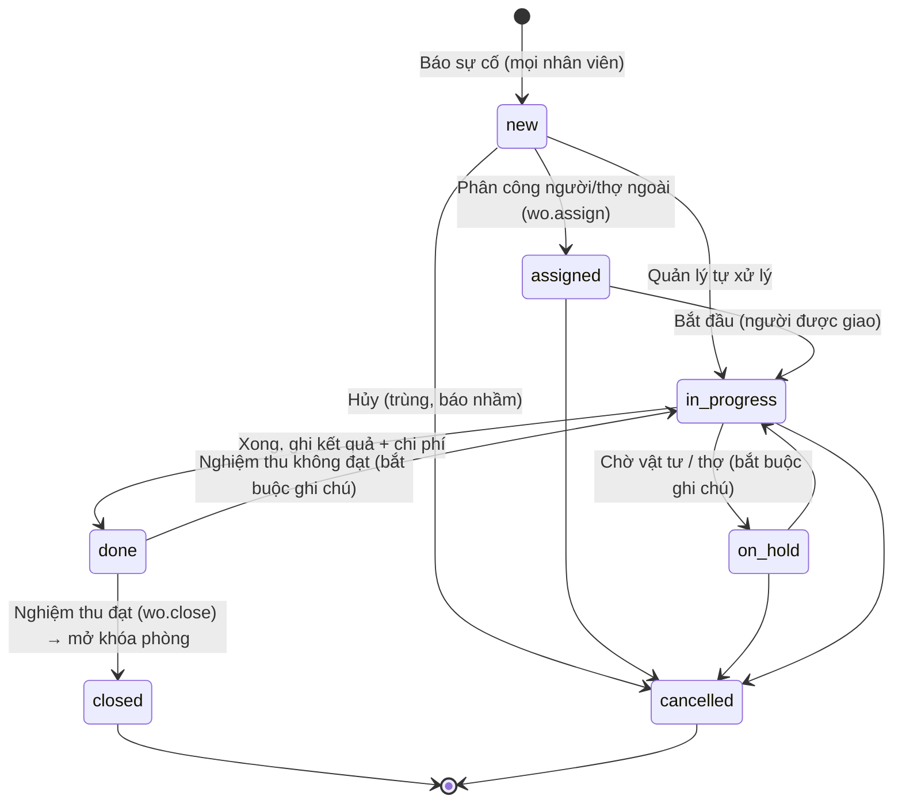

# 12 – Quản lý cơ sở vật chất (CSVC)

Yêu cầu bổ sung của chủ đầu tư (21/10/2026). Phạm vi: tài sản, sự cố và sửa chữa, bảo trì định kỳ, kiểm tra theo checklist, hồ sơ pháp lý và kiểm định của 8 cơ sở. Kho vật tư tiêu hao (amenities) và mua sắm **không** thuộc giai đoạn này.

## 1. Mục tiêu đo được

| Mục tiêu | Chỉ số theo dõi (báo cáo ở 13) |
| --- | --- |
| Biết mỗi cơ sở có gì, ở đâu, còn bảo hành không | Số tài sản theo hạng mục, tài sản sắp hết bảo hành |
| Sự cố được xử lý nhanh, không bị quên | Số phiếu mở, phiếu quá hạn, thời gian xử lý trung bình theo mức ưu tiên |
| Giảm phòng ngừng bán vì hỏng hóc | Số phòng-đêm bị khóa, ảnh hưởng tới công suất |
| Bảo trì trước khi hỏng | Tỷ lệ hoàn thành bảo trì định kỳ đúng hạn |
| Không quên gia hạn giấy tờ, kiểm định | Hồ sơ sắp hết hạn / đã hết hạn |
| Kiểm soát chi phí sửa chữa | Chi phí theo cơ sở, hạng mục, tài sản; so sánh cùng kỳ |
| Phát hiện tài sản hỏng lặp lại để thay mới | Tài sản có ≥ 3 phiếu trong 90 ngày |

## 2. Module và quyền

| Module | Nội dung | Phụ thuộc | Mặc định |
| --- | --- | --- | --- |
| `facilities` | Vị trí (khu vực), hạng mục tài sản, sổ tài sản, nhà cung cấp/thợ | — | Bật |
| `work_orders` | Phiếu sự cố/sửa chữa, khóa phòng ngừng bán, chi phí | `facilities` | Bật |
| `preventive` | Kế hoạch bảo trì định kỳ, tự tạo phiếu khi đến hạn | `facilities`, `work_orders` | Bật |
| `inspections` | Mẫu checklist, kiểm tra phòng/khu vực, mục không đạt tự sinh phiếu | `work_orders` | Tắt |
| `compliance` | Giấy phép, hồ sơ PCCC, kiểm định, bảo hiểm, hợp đồng; nhắc hạn | `facilities` | Bật |

| Quyền | Lễ tân | Kỹ thuật | Quản lý | Chủ chuỗi |
| --- | --- | --- | --- | --- |
| `facility.view` Xem tài sản, vị trí, nhà cung cấp | ✓ | ✓ | ✓ | ✓ |
| `facility.manage` Thêm/sửa tài sản, vị trí, nhà cung cấp | | | ✓ | ✓ |
| `wo.view`, `wo.create` Xem, báo sự cố | ✓ | ✓ | ✓ | ✓ |
| `room.block` Khóa phòng ngừng bán | ✓ | ✓ | ✓ | ✓ |
| `wo.assign` Phân công, ưu tiên, hủy phiếu | | | ✓ | ✓ |
| `wo.work` Cập nhật tiến độ, chi phí phiếu được giao | | ✓ | ✓ | ✓ |
| `wo.close` Nghiệm thu, đóng phiếu | | | ✓ | ✓ |
| `pm.view` / `pm.manage` Bảo trì định kỳ | | xem | ✓ | ✓ |
| `inspection.perform` / `inspection.manage` | thực hiện | thực hiện | ✓ | ✓ |
| `compliance.view` / `compliance.manage` | xem | xem | ✓ | ✓ |

Vai trò **Kỹ thuật, bảo trì** là vai trò mới; CĐT chưa nêu số tài khoản, tạo khi có người. Khi chưa có, quản lý tự nhận phiếu hoặc giao cho nhà cung cấp/thợ ngoài (`vendor_id`).

## 3. Luồng nghiệp vụ

### 3.1 Phiếu sự cố / sửa chữa



Quy tắc:

- Ai cũng báo được sự cố từ điện thoại: chọn phòng hoặc khu vực, chọn tài sản (nếu biết), mô tả, chụp ảnh, mức ưu tiên.
- Tích **"Phòng ngừng bán"** → tạo khóa phòng ngay; check-in vào phòng đó bị chặn; phòng-đêm bị khóa được trừ khỏi mẫu số công suất. Khóa tự mở khi phiếu được nghiệm thu đóng hoặc bị hủy.
- Hạn xử lý mặc định theo ưu tiên (`app_settings['wo.sla_hours']`): Khẩn cấp 4 giờ, Cao 24 giờ, Thường 72 giờ, Thấp 7 ngày.
- Người được giao chỉ đổi trạng thái phiếu của mình; quản lý đổi được mọi phiếu.
- Chuyển trạng thái được kiểm tra bằng bảng `wo_transitions` trong DB, giao diện đọc cùng bảng này để hiện đúng nút, nên chỉ có **một nguồn quy tắc**.
- Tài sản gắn với phiếu tự đổi trạng thái: báo hỏng → `broken`, đang sửa → `under_repair`, đóng phiếu → `in_use` (nếu không còn phiếu mở khác).

### 3.2 Bảo trì định kỳ

1. Quản lý lập kế hoạch: tên việc, tài sản hoặc hạng mục hoặc khu vực, chu kỳ (ngày), số ngày tạo phiếu trước hạn, checklist các bước, người/thợ mặc định.
2. Job hằng đêm tạo phiếu `preventive` khi đến ngày `hạn - số ngày báo trước`, nếu kế hoạch chưa có phiếu đang mở.
3. Đóng phiếu → hạn kế tiếp = hạn cũ + chu kỳ (giữ lịch cố định, không trôi theo ngày làm thực tế).
4. Tỷ lệ đúng hạn = phiếu định kỳ hoàn thành trước hạn / phiếu định kỳ đến hạn trong kỳ.

Gợi ý kế hoạch mẫu khi khởi tạo (quản lý chỉnh theo thiết bị thực tế và khuyến cáo nhà sản xuất):

| Việc | Chu kỳ gợi ý |
| --- | --- |
| Vệ sinh lưới lọc điều hòa phòng khách | 30 ngày |
| Kiểm tra vòi, bồn cầu, thoát nước, keo silicon phòng tắm | 90 ngày |
| Kiểm tra đèn, ổ cắm, công tắc | 90 ngày |
| Kiểm tra nội thất, nệm, rèm | 180 ngày |
| Bảo dưỡng tổng thể điều hòa (thợ ngoài) | 180 ngày |
| Tự kiểm tra an toàn PCCC của cơ sở | 30 ngày (kiểm tra thường xuyên), 180/365 ngày (định kỳ, tuỳ cơ sở thuộc danh mục nào) |
| Vệ sinh bể nước | 180 ngày |
| Bảo trì thang máy, máy phát điện, máy bơm | Theo hợp đồng bảo trì |

Tần suất tự kiểm tra PCCC lấy theo quy định hiện hành: kiểm tra thường xuyên không quá 1 lần/tháng; kiểm tra định kỳ 6 tháng/lần với cơ sở có nguy hiểm cháy nổ (Phụ lục II) và 1 năm/lần với cơ sở còn lại (Phụ lục I) ([LuatVietnam](https://luatvietnam.vn/linh-vuc-khac/kiem-tra-an-toan-ve-pccc-883-98534-article.html)). Cần xác nhận từng cơ sở thuộc phụ lục nào.

### 3.3 Kiểm tra theo checklist (module `inspections`, mặc định tắt)

- Mẫu checklist: kiểm tra phòng trước khi bán lại sau sửa chữa, kiểm tra phòng định kỳ, tự kiểm tra PCCC, khu vực chung.
- Người kiểm tra mở trên điện thoại, chấm từng mục Đạt / Không đạt / Không áp dụng, chụp ảnh mục lỗi.
- Gửi → hệ thống tính điểm, mỗi mục **không đạt** tự sinh một phiếu sửa chữa (mục "nghiêm trọng" → ưu tiên Cao).

### 3.4 Hồ sơ pháp lý và kiểm định

- Mỗi cơ sở có danh sách hồ sơ theo loại: số, nơi cấp, ngày cấp, ngày hết hạn, file scan.
- Nhắc trước hạn `remind_days` (mặc định 30 ngày) trên trang Cảnh báo và trong báo cáo tuần.
- Gia hạn = thêm bản mới, bản cũ chuyển `is_current = false` (giữ lịch sử).
- Chu kỳ kiểm định thiết bị (thang máy, thiết bị áp lực...) **không hardcode**: quản lý nhập ngày hết hạn ghi trên biên bản kiểm định.

### 3.5 Cảnh báo CSVC (một trang tổng hợp)

| Cảnh báo | Điều kiện |
| --- | --- |
| Phiếu quá hạn | Phiếu chưa xong, `due_at` đã qua |
| Phòng khóa lâu | Phòng bị khóa quá 72 giờ |
| Hỏng lặp lại | Tài sản có ≥ 3 phiếu sửa/kiểm tra trong 90 ngày → cân nhắc thay mới |
| Bảo trì định kỳ quá hạn | Kế hoạch có `next_due_date` đã qua |
| Sắp hết bảo hành | Tài sản hết bảo hành trong 30 ngày tới |
| Hồ sơ sắp hết hạn / đã hết hạn | Theo `remind_days` của loại hồ sơ |

## 4. SQL

```sql
-- 20261101000012_facilities.sql
create type public.asset_status as enum ('in_use', 'in_storage', 'broken', 'under_repair', 'disposed');
create type public.wo_kind      as enum ('corrective', 'preventive', 'inspection', 'request');
create type public.wo_priority  as enum ('urgent', 'high', 'normal', 'low');
create type public.wo_status    as enum ('new', 'assigned', 'in_progress', 'on_hold', 'done', 'closed', 'cancelled');

-- Khu vực ngoài phòng: sảnh, bếp, hồ bơi, phòng máy, mái, kho...
create table public.facility_locations (
  id         uuid primary key default gen_random_uuid(),
  branch_id  uuid not null references public.branches(id),
  name       text not null check (char_length(name) between 2 and 120),
  kind       text not null default 'area' check (kind in ('area', 'floor', 'technical', 'outdoor', 'storage', 'other')),
  is_active  boolean not null default true,
  created_at timestamptz not null default now(),
  unique (branch_id, name),
  unique (id, branch_id)
);

create table public.asset_categories (
  id                  uuid primary key default gen_random_uuid(),
  code                text not null unique check (code ~ '^[a-z0-9_]{2,30}$'),
  name                text not null,
  default_life_months int check (default_life_months > 0),
  sort                int not null default 0
);

create table public.vendors (
  id           uuid primary key default gen_random_uuid(),
  name         text not null check (char_length(name) between 2 and 160),
  services     text[] not null default '{}',
  contact_name text,
  phone        text,
  email        text,
  tax_code     text,
  address      text,
  rating       smallint check (rating between 1 and 5),
  note         text,
  is_active    boolean not null default true,
  created_at   timestamptz not null default now(),
  updated_at   timestamptz not null default now()
);
create unique index vendors_name_uq on public.vendors (lower(name));

create table public.assets (
  id                   uuid primary key default gen_random_uuid(),
  branch_id            uuid not null references public.branches(id),
  code                 text not null unique check (code ~ '^[A-Z0-9-]{3,30}$'),   -- in tem QR dán lên tài sản
  name                 text not null check (char_length(name) between 2 and 160),
  category_id          uuid not null references public.asset_categories(id),
  room_id              uuid,
  location_id          uuid,
  brand                text,
  model                text,
  serial_no            text,
  vendor_id            uuid references public.vendors(id),
  purchase_date        date,
  purchase_cost        numeric(14, 0) check (purchase_cost >= 0),
  warranty_until       date,
  expected_life_months int check (expected_life_months > 0),
  quantity             int not null default 1 check (quantity > 0),     -- quản lý theo lô: ghế, rèm, khăn...
  status               public.asset_status not null default 'in_use',
  note                 text,
  disposed_on          date,
  disposed_reason      text,
  created_by           uuid references public.profiles(id),
  created_at           timestamptz not null default now(),
  updated_at           timestamptz not null default now(),
  foreign key (room_id, branch_id)     references public.rooms(id, branch_id),
  foreign key (location_id, branch_id) references public.facility_locations(id, branch_id),
  check (room_id is null or location_id is null),
  check (status <> 'disposed' or disposed_on is not null)
);
create index assets_branch_status_idx on public.assets(branch_id, status);
create index assets_room_idx          on public.assets(room_id) where room_id is not null;
create index assets_category_idx      on public.assets(category_id);
create index assets_warranty_idx      on public.assets(warranty_until) where status <> 'disposed';

create table public.pm_plans (
  id                  uuid primary key default gen_random_uuid(),
  branch_id           uuid not null references public.branches(id),
  name                text not null check (char_length(name) between 3 and 160),
  asset_id            uuid references public.assets(id),
  category_id         uuid references public.asset_categories(id),
  location_id         uuid,
  interval_days       int not null check (interval_days between 1 and 3650),
  lead_days           int not null default 7 check (lead_days between 0 and 90),
  checklist           text[] not null default '{}',
  default_assignee_id uuid references public.profiles(id),
  vendor_id           uuid references public.vendors(id),
  next_due_date       date not null,
  last_done_date      date,
  is_active           boolean not null default true,
  created_by          uuid references public.profiles(id),
  created_at          timestamptz not null default now(),
  updated_at          timestamptz not null default now(),
  foreign key (location_id, branch_id) references public.facility_locations(id, branch_id)
);
create index pm_plans_due_idx on public.pm_plans(next_due_date) where is_active;

create table public.checklist_templates (
  id         uuid primary key default gen_random_uuid(),
  name       text not null,
  scope      text not null check (scope in ('room', 'area', 'fire_safety', 'other')),
  -- [{"key": "ac", "label": "Điều hòa chạy êm, không chảy nước", "critical": true}, ...]
  items      jsonb not null check (jsonb_typeof(items) = 'array' and jsonb_array_length(items) between 1 and 200),
  is_active  boolean not null default true,
  created_by uuid references public.profiles(id),
  created_at timestamptz not null default now(),
  updated_at timestamptz not null default now()
);

create table public.inspections (
  id           uuid primary key default gen_random_uuid(),
  branch_id    uuid not null references public.branches(id),
  template_id  uuid not null references public.checklist_templates(id),
  room_id      uuid,
  location_id  uuid,
  inspector_id uuid not null references public.profiles(id),
  performed_at timestamptz not null default now(),
  -- [{"key": "ac", "status": "pass" | "fail" | "na", "note": "...", "photo_path": "..."}]
  results      jsonb not null,
  passed       int not null,
  failed       int not null,
  score        numeric(5, 2),
  note         text,
  foreign key (room_id, branch_id)     references public.rooms(id, branch_id),
  foreign key (location_id, branch_id) references public.facility_locations(id, branch_id)
);
create index inspections_branch_idx on public.inspections(branch_id, performed_at desc);

create table public.work_orders (
  id            uuid primary key default gen_random_uuid(),
  number        bigint generated always as identity unique,        -- hiển thị "Phiếu #1024"
  branch_id     uuid not null references public.branches(id),
  kind          public.wo_kind not null default 'corrective',
  title         text not null check (char_length(title) between 3 and 200),
  description   text check (char_length(description) <= 4000),
  priority      public.wo_priority not null default 'normal',
  status        public.wo_status not null default 'new',
  room_id       uuid,
  location_id   uuid,
  asset_id      uuid references public.assets(id),
  blocks_room   boolean not null default false,
  reported_by   uuid references public.profiles(id),               -- null = hệ thống tạo (bảo trì định kỳ)
  reported_at   timestamptz not null default now(),
  assignee_id   uuid references public.profiles(id),
  vendor_id     uuid references public.vendors(id),
  due_at        timestamptz,
  started_at    timestamptz,
  completed_at  timestamptz,
  closed_at     timestamptz,
  closed_by     uuid references public.profiles(id),
  resolution    text,
  checklist     jsonb not null default '[]',                        -- [{"label": "...", "done": false}]
  labor_cost    numeric(14, 0) not null default 0 check (labor_cost >= 0),
  parts_cost    numeric(14, 0) not null default 0 check (parts_cost >= 0),
  vendor_cost   numeric(14, 0) not null default 0 check (vendor_cost >= 0),
  total_cost    numeric(14, 0) generated always as (labor_cost + parts_cost + vendor_cost) stored,
  pm_plan_id    uuid references public.pm_plans(id),
  inspection_id uuid references public.inspections(id),
  photo_paths   text[] not null default '{}',
  created_at    timestamptz not null default now(),
  updated_at    timestamptz not null default now(),
  foreign key (room_id, branch_id)     references public.rooms(id, branch_id),
  foreign key (location_id, branch_id) references public.facility_locations(id, branch_id),
  check (room_id is null or location_id is null),
  check (not blocks_room or room_id is not null),
  check (status not in ('done', 'closed') or completed_at is not null)
);
create index wo_branch_status_idx on public.work_orders(branch_id, status);
create index wo_branch_reported_idx on public.work_orders(branch_id, reported_at desc);
create index wo_asset_idx on public.work_orders(asset_id, reported_at desc) where asset_id is not null;
create index wo_assignee_open_idx on public.work_orders(assignee_id) where status in ('assigned', 'in_progress', 'on_hold');
create index wo_pm_open_idx on public.work_orders(pm_plan_id) where status not in ('closed', 'cancelled');

alter table public.room_blocks
  add constraint room_blocks_wo_fk foreign key (work_order_id) references public.work_orders(id);

create table public.work_order_events (
  id            bigint generated always as identity primary key,
  work_order_id uuid not null references public.work_orders(id) on delete cascade,
  at            timestamptz not null default now(),
  actor_id      uuid references public.profiles(id),
  from_status   public.wo_status,
  to_status     public.wo_status,
  comment       text
);
create index wo_events_idx on public.work_order_events(work_order_id, at);

-- Một nguồn quy tắc chuyển trạng thái cho cả DB và giao diện
create table public.wo_transitions (
  from_status      public.wo_status not null,
  to_status        public.wo_status not null,
  permission_key   text not null references public.permissions(key),
  assignee_may     boolean not null default false,   -- người được giao (có wo.work) cũng được làm
  requires_comment boolean not null default false,
  label            text not null,                     -- chữ trên nút
  primary key (from_status, to_status)
);

create table public.compliance_doc_types (
  id           uuid primary key default gen_random_uuid(),
  code         text not null unique check (code ~ '^[a-z0-9_]{2,40}$'),
  name         text not null,
  applies_to   text not null default 'branch' check (applies_to in ('branch', 'asset')),
  remind_days  int not null default 30 check (remind_days between 0 and 365),
  sort         int not null default 0
);

create table public.compliance_docs (
  id          uuid primary key default gen_random_uuid(),
  branch_id   uuid not null references public.branches(id),
  doc_type_id uuid not null references public.compliance_doc_types(id),
  asset_id    uuid references public.assets(id),
  number      text,
  issuer      text,
  issued_on   date,
  expires_on  date,
  file_paths  text[] not null default '{}',
  note        text,
  is_current  boolean not null default true,
  created_by  uuid references public.profiles(id),
  created_at  timestamptz not null default now(),
  updated_at  timestamptz not null default now(),
  check (expires_on is null or issued_on is null or expires_on >= issued_on)
);
create index compliance_expiry_idx on public.compliance_docs(branch_id, expires_on) where is_current;

do $$
declare t text;
begin
  foreach t in array array['vendors', 'assets', 'pm_plans', 'checklist_templates', 'work_orders', 'compliance_docs'] loop
    execute format('create trigger %I before update on public.%I for each row execute function private.set_updated_at()',
                   t || '_updated_at', t);
  end loop;
end $$;

do $$
declare t text;
begin
  foreach t in array array['facility_locations', 'vendors', 'assets', 'pm_plans', 'checklist_templates',
                           'work_orders', 'inspections', 'compliance_docs', 'asset_categories'] loop
    execute format('create trigger %I after insert or update or delete on public.%I
                    for each row execute function private.audit_row()', t || '_audit', t);
  end loop;
end $$;
```

### 4.1 Danh mục khởi tạo

```sql
insert into public.wo_transitions (from_status, to_status, permission_key, assignee_may, requires_comment, label) values
  ('new',         'assigned',    'wo.assign', false, false, 'Phân công'),
  ('new',         'in_progress', 'wo.assign', false, false, 'Tự xử lý'),
  ('assigned',    'in_progress', 'wo.assign', true,  false, 'Bắt đầu'),
  ('in_progress', 'on_hold',     'wo.assign', true,  true,  'Tạm dừng'),
  ('on_hold',     'in_progress', 'wo.assign', true,  false, 'Tiếp tục'),
  ('in_progress', 'done',        'wo.assign', true,  false, 'Hoàn thành'),
  ('done',        'closed',      'wo.close',  false, false, 'Nghiệm thu đạt'),
  ('done',        'in_progress', 'wo.close',  false, true,  'Nghiệm thu không đạt'),
  ('new',         'cancelled',   'wo.assign', false, true,  'Hủy phiếu'),
  ('assigned',    'cancelled',   'wo.assign', false, true,  'Hủy phiếu'),
  ('on_hold',     'cancelled',   'wo.assign', false, true,  'Hủy phiếu'),
  ('in_progress', 'cancelled',   'wo.assign', false, true,  'Hủy phiếu');

insert into public.asset_categories (code, name, default_life_months, sort) values
  ('air_con',      'Điều hòa',                      96,  1),
  ('water_heater', 'Bình nóng lạnh',                72,  2),
  ('tv',           'Tivi',                          72,  3),
  ('minibar',      'Tủ lạnh mini',                  72,  4),
  ('bed',          'Giường, nệm',                   96,  5),
  ('furniture',    'Nội thất (bàn, ghế, tủ)',       120, 6),
  ('sanitary',     'Thiết bị vệ sinh',              120, 7),
  ('lighting',     'Đèn, điện',                     60,  8),
  ('door_lock',    'Khóa từ, khóa cửa',             84,  9),
  ('network',      'Wifi, mạng, camera',            60,  10),
  ('pump',         'Máy bơm, xử lý nước',           96,  11),
  ('generator',    'Máy phát điện',                 180, 12),
  ('elevator',     'Thang máy',                     240, 13),
  ('fire_safety',  'Thiết bị PCCC',                 null, 14),
  ('laundry',      'Thiết bị giặt là',              96,  15),
  ('kitchen',      'Thiết bị bếp',                  96,  16),
  ('pool',         'Hồ bơi, thiết bị hồ bơi',       null, 17),
  ('other',        'Khác',                          null, 99);

insert into public.compliance_doc_types (code, name, applies_to, remind_days, sort) values
  ('business_registration', 'Giấy chứng nhận đăng ký kinh doanh / hộ kinh doanh', 'branch', 30, 1),
  ('security_order',        'Giấy chứng nhận đủ điều kiện về an ninh, trật tự',   'branch', 30, 2),
  ('fire_dossier',          'Hồ sơ PCCC, biên bản kiểm tra PCCC',                 'branch', 30, 3),
  ('fire_insurance',        'Bảo hiểm cháy nổ bắt buộc',                          'branch', 30, 4),
  ('star_rating',           'Quyết định công nhận hạng sao (nếu có)',             'branch', 60, 5),
  ('lease',                 'Hợp đồng thuê mặt bằng',                             'branch', 90, 6),
  ('maintenance_contract',  'Hợp đồng bảo trì (thang máy, PCCC, điều hòa...)',    'branch', 30, 7),
  ('water_test',            'Kết quả xét nghiệm chất lượng nước',                 'branch', 30, 8),
  ('elevator_inspection',   'Biên bản kiểm định thang máy',                       'asset',  30, 9),
  ('pressure_inspection',   'Biên bản kiểm định thiết bị áp lực, nồi hơi',        'asset',  30, 10);

insert into public.app_settings (key, value) values
  ('wo.sla_hours', '{"urgent": 4, "high": 24, "normal": 72, "low": 168}');
```

Danh sách loại hồ sơ là gợi ý ban đầu; quản lý thêm/bớt theo thực tế từng cơ sở. Chu kỳ gia hạn, kiểm định do người nhập lấy từ giấy tờ thật, không hardcode.

### 4.2 RLS

```sql
do $$
declare t text;
begin
  foreach t in array array['facility_locations', 'asset_categories', 'vendors', 'assets', 'pm_plans',
                           'checklist_templates', 'inspections', 'work_orders', 'work_order_events',
                           'wo_transitions', 'compliance_doc_types', 'compliance_docs'] loop
    execute format('alter table public.%I enable row level security', t);
    execute format('revoke all on public.%I from anon', t);
  end loop;
end $$;

-- Danh mục chung
create policy read_all on public.wo_transitions       for select to authenticated using (true);
create policy read_all on public.compliance_doc_types for select to authenticated using (true);
create policy read_cat on public.asset_categories for select to authenticated
  using (private.has_perm('facility.view') or private.has_perm('wo.view'));
create policy write_cat on public.asset_categories for insert to authenticated
  with check (private.has_perm('facility.manage'));
create policy read_vendor on public.vendors for select to authenticated
  using (private.has_perm('facility.view') or private.has_perm('wo.view'));
create policy write_vendor on public.vendors for insert to authenticated
  with check (private.has_perm('facility.manage'));
create policy update_vendor on public.vendors for update to authenticated
  using (private.has_perm('facility.manage')) with check (private.has_perm('facility.manage'));
create policy write_doc_type on public.compliance_doc_types for insert to authenticated
  with check (private.has_perm('compliance.manage'));

-- Theo cơ sở: đọc theo quyền xem, ghi trực tiếp theo quyền quản lý (danh mục đơn giản)
create policy read_branch on public.facility_locations for select to authenticated
  using (branch_id in (select private.branches_with('facility.view'))
         or branch_id in (select private.branches_with('wo.create')));
create policy write_branch on public.facility_locations for insert to authenticated
  with check (private.has_perm('facility.manage', branch_id));
create policy update_branch on public.facility_locations for update to authenticated
  using (private.has_perm('facility.manage', branch_id)) with check (private.has_perm('facility.manage', branch_id));

create policy read_branch on public.assets for select to authenticated
  using (branch_id in (select private.branches_with('facility.view'))
         or branch_id in (select private.branches_with('wo.create')));
create policy write_branch on public.assets for insert to authenticated
  with check (private.has_perm('facility.manage', branch_id));
create policy update_branch on public.assets for update to authenticated
  using (private.has_perm('facility.manage', branch_id)) with check (private.has_perm('facility.manage', branch_id));

create policy read_branch on public.pm_plans for select to authenticated
  using (branch_id in (select private.branches_with('pm.view')));
create policy write_branch on public.pm_plans for insert to authenticated
  with check (private.has_perm('pm.manage', branch_id));
create policy update_branch on public.pm_plans for update to authenticated
  using (private.has_perm('pm.manage', branch_id)) with check (private.has_perm('pm.manage', branch_id));

create policy read_tpl on public.checklist_templates for select to authenticated
  using (private.has_perm('inspection.perform') or private.has_perm('inspection.manage'));
create policy write_tpl on public.checklist_templates for insert to authenticated
  with check (private.has_perm('inspection.manage'));
create policy update_tpl on public.checklist_templates for update to authenticated
  using (private.has_perm('inspection.manage')) with check (private.has_perm('inspection.manage'));

create policy read_branch on public.inspections for select to authenticated
  using (branch_id in (select private.branches_with('inspection.perform'))
         or branch_id in (select private.branches_with('wo.view')));

create policy read_branch on public.work_orders for select to authenticated
  using (branch_id in (select private.branches_with('wo.view')));
create policy read_events on public.work_order_events for select to authenticated
  using (exists (select 1 from public.work_orders w where w.id = work_order_events.work_order_id));

create policy read_branch on public.compliance_docs for select to authenticated
  using (branch_id in (select private.branches_with('compliance.view')));
create policy write_branch on public.compliance_docs for insert to authenticated
  with check (private.has_perm('compliance.manage', branch_id));
create policy update_branch on public.compliance_docs for update to authenticated
  using (private.has_perm('compliance.manage', branch_id)) with check (private.has_perm('compliance.manage', branch_id));

-- Ảnh sự cố, file hồ sơ: bucket riêng tư, đường dẫn "<branch_id>/<loại>/<uuid>.<ext>"
insert into storage.buckets (id, name, public, file_size_limit, allowed_mime_types)
values ('facility-files', 'facility-files', false, 10485760,
        array['image/jpeg', 'image/png', 'image/webp', 'application/pdf']);

create policy facility_files_read on storage.objects for select to authenticated using (
  bucket_id = 'facility-files'
  and (split_part(name, '/', 1))::uuid in (
    select private.branches_with('wo.view') union select private.branches_with('compliance.view')));
create policy facility_files_upload on storage.objects for insert to authenticated with check (
  bucket_id = 'facility-files'
  and (split_part(name, '/', 1))::uuid in (
    select private.branches_with('wo.create') union select private.branches_with('compliance.manage')
    union select private.branches_with('facility.manage')));
```

Phiếu sự cố, khóa phòng, kiểm tra **không** ghi trực tiếp được; chỉ qua RPC dưới đây.

### 4.3 RPC phiếu sự cố

```sql
-- p: {"branch_id", "title", "description"?, "priority"?, "kind"?: "corrective"|"request",
--     "room_id"?, "location_id"?, "asset_id"?, "blocks_room"?: bool, "photo_paths"?: [], "due_at"?}
create or replace function public.create_work_order(p jsonb)
returns jsonb language plpgsql security definer set search_path = '' as $$
declare
  v_branch   uuid := (p ->> 'branch_id')::uuid;
  v_priority public.wo_priority := coalesce(nullif(p ->> 'priority', '')::public.wo_priority, 'normal');
  v_block    boolean := coalesce((p ->> 'blocks_room')::boolean, false);
  v_asset    uuid := nullif(p ->> 'asset_id', '')::uuid;
  v_room     uuid := nullif(p ->> 'room_id', '')::uuid;
  v_sla      int;
  v_wo       public.work_orders;
begin
  perform private.assert_perm_at('wo.create', v_branch);
  perform private.hit_rate_limit('wo_create', 30, 60);
  if v_block then
    perform private.assert_perm_at('room.block', v_branch);
  end if;
  if v_asset is not null and not exists (select 1 from public.assets where id = v_asset and branch_id = v_branch) then
    raise exception 'asset not in branch' using errcode = 'P0422';
  end if;
  if v_room is null and v_asset is not null then
    select room_id into v_room from public.assets where id = v_asset;   -- lấy phòng theo tài sản
  end if;

  select (value ->> v_priority::text)::int into v_sla from public.app_settings where key = 'wo.sla_hours';

  insert into public.work_orders (branch_id, kind, title, description, priority, room_id, location_id, asset_id,
                                  blocks_room, reported_by, due_at, photo_paths)
  values (v_branch,
          coalesce(nullif(p ->> 'kind', '')::public.wo_kind, 'corrective'),
          btrim(p ->> 'title'), nullif(p ->> 'description', ''), v_priority,
          v_room, nullif(p ->> 'location_id', '')::uuid, v_asset, v_block, (select auth.uid()),
          coalesce(nullif(p ->> 'due_at', '')::timestamptz, now() + make_interval(hours => coalesce(v_sla, 72))),
          coalesce(array(select jsonb_array_elements_text(p -> 'photo_paths')), '{}'))
  returning * into v_wo;

  insert into public.work_order_events (work_order_id, actor_id, to_status)
  values (v_wo.id, (select auth.uid()), 'new');

  if v_block then
    insert into public.room_blocks (branch_id, room_id, reason, work_order_id, created_by)
    values (v_branch, v_room, 'Phiếu #' || v_wo.number || ': ' || v_wo.title, v_wo.id, (select auth.uid()));
  end if;

  if v_asset is not null and v_wo.kind = 'corrective' then
    update public.assets set status = 'broken' where id = v_asset and status = 'in_use';
  end if;

  return jsonb_build_object('id', v_wo.id, 'number', v_wo.number, 'due_at', v_wo.due_at);
end $$;

-- Đưa tài sản về "đang dùng" khi không còn phiếu mở
create or replace function private.settle_asset(p_asset uuid)
returns void language sql security definer set search_path = '' as $$
  update public.assets a set status = 'in_use'
  where a.id = p_asset and a.status in ('broken', 'under_repair')
    and not exists (select 1 from public.work_orders w
                    where w.asset_id = p_asset and w.status not in ('done', 'closed', 'cancelled'));
$$;

-- p_patch dùng khi: to = 'assigned' → {"assignee_id"?, "vendor_id"?}
--                   to = 'done'     → {"resolution", "labor_cost"?, "parts_cost"?, "vendor_cost"?, "checklist"?}
create or replace function public.transition_work_order(
  p_id uuid, p_to public.wo_status, p_comment text default null,
  p_patch jsonb default '{}', p_expected_status public.wo_status default null)
returns void language plpgsql security definer set search_path = '' as $$
declare
  v_me  uuid := (select auth.uid());
  v_wo  public.work_orders;
  v_t   public.wo_transitions;
  v_assignee uuid;
  v_vendor   uuid;
  v_plan     public.pm_plans;
  v_next     date;
begin
  select * into v_wo from public.work_orders where id = p_id for update;
  if not found then raise exception 'work order not found' using errcode = 'P0404'; end if;
  if p_expected_status is not null and p_expected_status <> v_wo.status then
    raise exception 'status changed by someone else' using errcode = 'P0409';
  end if;

  select * into v_t from public.wo_transitions where from_status = v_wo.status and to_status = p_to;
  if not found then raise exception 'invalid transition % -> %', v_wo.status, p_to using errcode = 'P0422'; end if;

  if not (private.has_perm(v_t.permission_key, v_wo.branch_id)
          or (v_t.assignee_may and v_wo.assignee_id = v_me and private.has_perm('wo.work', v_wo.branch_id))) then
    raise exception 'forbidden: %', v_t.permission_key using errcode = 'P0403';
  end if;
  if v_t.requires_comment and char_length(btrim(coalesce(p_comment, ''))) < 3 then
    raise exception 'comment required' using errcode = 'P0422';
  end if;

  if p_to = 'assigned' then
    v_assignee := coalesce(nullif(p_patch ->> 'assignee_id', '')::uuid, v_wo.assignee_id);
    v_vendor   := coalesce(nullif(p_patch ->> 'vendor_id', '')::uuid, v_wo.vendor_id);
    if v_assignee is null and v_vendor is null then
      raise exception 'assignee or vendor required' using errcode = 'P0422';
    end if;
    if v_assignee is not null and not exists (
      select 1 from public.user_effective_permissions
      where user_id = v_assignee and branch_id = v_wo.branch_id and permission_key = 'wo.work') then
      raise exception 'assignee cannot work on this branch' using errcode = 'P0422';
    end if;
    update public.work_orders set assignee_id = v_assignee, vendor_id = v_vendor where id = p_id;

  elsif p_to = 'in_progress' then
    update public.work_orders
       set started_at = coalesce(started_at, now()),
           completed_at = null,
           assignee_id = coalesce(assignee_id, case when v_wo.status = 'new' then v_me end)
     where id = p_id;
    if v_wo.asset_id is not null then
      update public.assets set status = 'under_repair' where id = v_wo.asset_id and status in ('in_use', 'broken');
    end if;

  elsif p_to = 'done' then
    if char_length(btrim(coalesce(p_patch ->> 'resolution', v_wo.resolution, ''))) < 3 then
      raise exception 'resolution required' using errcode = 'P0422';
    end if;
    update public.work_orders set
      resolution   = coalesce(nullif(p_patch ->> 'resolution', ''), resolution),
      labor_cost   = coalesce((p_patch ->> 'labor_cost')::numeric, labor_cost),
      parts_cost   = coalesce((p_patch ->> 'parts_cost')::numeric, parts_cost),
      vendor_cost  = coalesce((p_patch ->> 'vendor_cost')::numeric, vendor_cost),
      checklist    = coalesce(p_patch -> 'checklist', checklist),
      completed_at = now()
    where id = p_id;

  elsif p_to in ('closed', 'cancelled') then
    update public.work_orders
       set closed_at = now(), closed_by = v_me
     where id = p_id;
    update public.room_blocks set released_at = now(), released_by = v_me
     where work_order_id = p_id and released_at is null;

    if p_to = 'closed' and v_wo.pm_plan_id is not null then
      select * into v_plan from public.pm_plans where id = v_wo.pm_plan_id for update;
      v_next := v_plan.next_due_date + v_plan.interval_days;
      while v_next <= (v_wo.completed_at at time zone 'Asia/Ho_Chi_Minh')::date loop
        v_next := v_next + v_plan.interval_days;
      end loop;
      update public.pm_plans
         set last_done_date = (v_wo.completed_at at time zone 'Asia/Ho_Chi_Minh')::date, next_due_date = v_next
       where id = v_plan.id;
    end if;
  end if;

  update public.work_orders set status = p_to where id = p_id;

  if p_to in ('closed', 'cancelled') and v_wo.asset_id is not null then
    perform private.settle_asset(v_wo.asset_id);
  end if;

  insert into public.work_order_events (work_order_id, actor_id, from_status, to_status, comment)
  values (p_id, v_me, v_wo.status, p_to, nullif(btrim(p_comment), ''));
end $$;

-- Khóa / mở phòng thủ công (cải tạo, giữ phòng cho đoàn kỹ thuật...) không gắn phiếu
create or replace function public.set_room_block(p_room_id uuid, p_reason text, p_ends_at timestamptz default null)
returns uuid language plpgsql security definer set search_path = '' as $$
declare
  v_branch uuid;
  v_id uuid;
begin
  select branch_id into v_branch from public.rooms where id = p_room_id;
  perform private.assert_perm_at('room.block', v_branch);
  if exists (select 1 from public.stays where room_id = p_room_id and status = 'in_house') then
    raise exception 'room is occupied' using errcode = 'P0412';
  end if;
  insert into public.room_blocks (branch_id, room_id, reason, ends_at, created_by)
  values (v_branch, p_room_id, p_reason, p_ends_at, (select auth.uid()))
  returning id into v_id;
  return v_id;
end $$;

create or replace function public.release_room_block(p_block_id uuid)
returns void language plpgsql security definer set search_path = '' as $$
declare
  v_b public.room_blocks;
begin
  select * into v_b from public.room_blocks where id = p_block_id for update;
  if not found then raise exception 'block not found' using errcode = 'P0404'; end if;
  perform private.assert_perm_at('room.block', v_b.branch_id);
  if v_b.work_order_id is not null then
    raise exception 'block belongs to a work order; close the order instead' using errcode = 'P0409';
  end if;
  update public.room_blocks set released_at = now(), released_by = (select auth.uid())
   where id = p_block_id and released_at is null;
end $$;
```

### 4.4 RPC kiểm tra theo checklist

```sql
-- p: {"branch_id", "template_id", "room_id"?, "location_id"?, "note"?,
--     "results": [{"key": "ac", "status": "pass"|"fail"|"na", "note"?: "...", "photo_path"?: "..."}]}
create or replace function public.submit_inspection(p jsonb)
returns jsonb language plpgsql security definer set search_path = '' as $$
declare
  v_branch uuid := (p ->> 'branch_id')::uuid;
  v_tpl    public.checklist_templates;
  v_pass   int;
  v_fail   int;
  v_id     uuid;
  v_wo_ids uuid[] := '{}';
  r        record;
  v_wo     jsonb;
begin
  perform private.assert_perm_at('inspection.perform', v_branch);
  select * into v_tpl from public.checklist_templates where id = (p ->> 'template_id')::uuid and is_active;
  if not found then raise exception 'template not found' using errcode = 'P0404'; end if;

  -- Mọi mục trong mẫu phải có kết quả hợp lệ
  if exists (
    select 1 from jsonb_array_elements(v_tpl.items) i
    where not exists (select 1 from jsonb_array_elements(p -> 'results') x
                      where x ->> 'key' = i ->> 'key' and x ->> 'status' in ('pass', 'fail', 'na'))) then
    raise exception 'every checklist item needs a result' using errcode = 'P0422';
  end if;

  select count(*) filter (where x ->> 'status' = 'pass'), count(*) filter (where x ->> 'status' = 'fail')
    into v_pass, v_fail
  from jsonb_array_elements(p -> 'results') x;

  insert into public.inspections (branch_id, template_id, room_id, location_id, inspector_id, results,
                                  passed, failed, score, note)
  values (v_branch, v_tpl.id, nullif(p ->> 'room_id', '')::uuid, nullif(p ->> 'location_id', '')::uuid,
          (select auth.uid()), p -> 'results', v_pass, v_fail,
          round(100.0 * v_pass / nullif(v_pass + v_fail, 0), 2), nullif(p ->> 'note', ''))
  returning id into v_id;

  -- Mỗi mục không đạt sinh một phiếu sửa chữa
  for r in
    select i ->> 'label' as label, coalesce((i ->> 'critical')::boolean, false) as critical, x ->> 'note' as note
    from jsonb_array_elements(v_tpl.items) i
    join jsonb_array_elements(p -> 'results') x on x ->> 'key' = i ->> 'key'
    where x ->> 'status' = 'fail'
  loop
    v_wo := public.create_work_order(jsonb_build_object(
      'branch_id', v_branch, 'kind', 'corrective',
      'title', left('Kiểm tra: ' || r.label, 200), 'description', r.note,
      'priority', case when r.critical then 'high' else 'normal' end,
      'room_id', p ->> 'room_id', 'location_id', p ->> 'location_id'));
    update public.work_orders set kind = 'inspection', inspection_id = v_id where id = (v_wo ->> 'id')::uuid;
    v_wo_ids := v_wo_ids || (v_wo ->> 'id')::uuid;
  end loop;

  return jsonb_build_object('inspection_id', v_id, 'score', round(100.0 * v_pass / nullif(v_pass + v_fail, 0), 2),
                            'work_order_ids', to_jsonb(v_wo_ids));
end $$;
```

Người kiểm tra cần thêm quyền `wo.create` (đã có ở mọi vai trò mặc định) vì RPC sinh phiếu.

### 4.5 Bảo trì định kỳ: job tạo phiếu

```sql
create or replace function private.generate_pm_work_orders()
returns int language plpgsql security definer set search_path = '' as $$
declare
  v_today date := (now() at time zone 'Asia/Ho_Chi_Minh')::date;
  v_count int := 0;
  pl public.pm_plans;
  v_wo uuid;
begin
  for pl in
    select * from public.pm_plans p
    where p.is_active
      and p.next_due_date - p.lead_days <= v_today
      and private.module_state(p.branch_id, 'preventive') = 'on'
      and not exists (select 1 from public.work_orders w
                      where w.pm_plan_id = p.id and w.status not in ('closed', 'cancelled'))
  loop
    insert into public.work_orders (branch_id, kind, title, priority, status, asset_id, location_id,
                                    assignee_id, vendor_id, due_at, checklist, pm_plan_id, room_id)
    values (pl.branch_id, 'preventive', left('Bảo trì định kỳ: ' || pl.name, 200), 'normal',
            case when pl.default_assignee_id is not null or pl.vendor_id is not null
                 then 'assigned'::public.wo_status else 'new' end,
            pl.asset_id, pl.location_id, pl.default_assignee_id, pl.vendor_id,
            ((pl.next_due_date + time '17:00') at time zone 'Asia/Ho_Chi_Minh'),
            coalesce((select jsonb_agg(jsonb_build_object('label', c, 'done', false)) from unnest(pl.checklist) c), '[]'),
            pl.id,
            (select a.room_id from public.assets a where a.id = pl.asset_id))
    returning id into v_wo;
    insert into public.work_order_events (work_order_id, to_status, comment)
    values (v_wo, 'new', 'Hệ thống tạo theo kế hoạch bảo trì định kỳ');
    v_count := v_count + 1;
  end loop;
  return v_count;
end $$;

select cron.schedule('generate-pm', '30 17 * * *', $$select private.generate_pm_work_orders()$$);   -- 00:30 giờ VN
```

### 4.6 Cảnh báo CSVC

```sql
create or replace function public.facility_alerts(p_branch_ids uuid[] default null)
returns table (kind text, severity text, branch_id uuid, ref_id uuid, title text, due date)
language plpgsql stable security definer set search_path = '' as $$
declare
  v_today date := (now() at time zone 'Asia/Ho_Chi_Minh')::date;
  v_br uuid[] := array(select x from private.branches_with('facility.view') x
                       where p_branch_ids is null or x = any (p_branch_ids));
begin
  if coalesce(array_length(v_br, 1), 0) = 0 then
    raise exception 'forbidden: facility.view' using errcode = 'P0403';
  end if;

  return query
  select 'wo_overdue', case when w.priority in ('urgent', 'high') then 'critical' else 'warning' end,
         w.branch_id, w.id, 'Phiếu #' || w.number || ' quá hạn: ' || w.title,
         (w.due_at at time zone 'Asia/Ho_Chi_Minh')::date
  from public.work_orders w
  where w.branch_id = any (v_br) and w.status in ('new', 'assigned', 'in_progress', 'on_hold') and w.due_at < now()
  union all
  select 'room_blocked_long', 'warning', rb.branch_id, rb.id,
         'Phòng ' || r.number || ' ngừng bán từ ' || to_char(rb.starts_at at time zone 'Asia/Ho_Chi_Minh', 'DD/MM'),
         (rb.starts_at at time zone 'Asia/Ho_Chi_Minh')::date
  from public.room_blocks rb join public.rooms r on r.id = rb.room_id
  where rb.branch_id = any (v_br) and rb.released_at is null and rb.starts_at < now() - interval '72 hours'
    and (rb.ends_at is null or rb.ends_at > now())
  union all
  select 'repeat_failure', 'warning', a.branch_id, a.id,
         a.name || ' (' || a.code || '): ' || count(*) || ' phiếu trong 90 ngày', null::date
  from public.assets a join public.work_orders w on w.asset_id = a.id
  where a.branch_id = any (v_br) and w.kind in ('corrective', 'inspection') and w.status <> 'cancelled'
    and w.reported_at > now() - interval '90 days'
  group by a.id, a.branch_id, a.name, a.code
  having count(*) >= 3
  union all
  select 'pm_overdue', 'warning', p.branch_id, p.id, 'Bảo trì định kỳ quá hạn: ' || p.name, p.next_due_date
  from public.pm_plans p
  where p.branch_id = any (v_br) and p.is_active and p.next_due_date < v_today
  union all
  select 'warranty_expiring', 'info', a.branch_id, a.id, 'Sắp hết bảo hành: ' || a.name || ' (' || a.code || ')', a.warranty_until
  from public.assets a
  where a.branch_id = any (v_br) and a.status <> 'disposed' and a.warranty_until between v_today and v_today + 30
  union all
  select case when d.expires_on < v_today then 'compliance_expired' else 'compliance_expiring' end,
         case when d.expires_on < v_today then 'critical' else 'warning' end,
         d.branch_id, d.id, t.name || coalesce(' số ' || d.number, ''), d.expires_on
  from public.compliance_docs d join public.compliance_doc_types t on t.id = d.doc_type_id
  where d.branch_id = any (v_br) and d.is_current and d.expires_on is not null
    and d.expires_on <= v_today + t.remind_days
    and private.has_perm('compliance.view', d.branch_id)
  order by 2, 6 nulls last;
end $$;

do $$
declare fn text;
begin
  foreach fn in array array[
    'public.create_work_order(jsonb)',
    'public.transition_work_order(uuid, public.wo_status, text, jsonb, public.wo_status)',
    'public.set_room_block(uuid, text, timestamptz)',
    'public.release_room_block(uuid)',
    'public.submit_inspection(jsonb)',
    'public.facility_alerts(uuid[])'
  ] loop
    execute format('revoke all on function %s from public, anon', fn);
    execute format('grant execute on function %s to authenticated', fn);
  end loop;
end $$;
```

## 5. Màn hình

| Route | Người dùng | Nội dung |
| --- | --- | --- |
| `/facilities/report` | Mọi nhân viên (điện thoại) | Báo sự cố nhanh: chọn phòng/khu vực → tài sản (hoặc quét tem QR tài sản) → mô tả, ảnh, ưu tiên, tích "Phòng ngừng bán" |
| `/facilities/work-orders` | Kỹ thuật, quản lý | Bảng phiếu (lọc cơ sở, trạng thái, ưu tiên, người giao), dạng Kanban theo trạng thái trên desktop; "Phiếu của tôi" trên điện thoại |
| `/facilities/work-orders/[id]` | Kỹ thuật, quản lý | Chi tiết, dòng thời gian sự kiện, nút chuyển trạng thái đọc từ `wo_transitions`, chi phí, checklist, ảnh trước/sau |
| `/facilities/assets` | Quản lý | Sổ tài sản theo cơ sở/phòng/hạng mục; nhập hàng loạt từ Excel; in tem QR mã tài sản |
| `/facilities/assets/[id]` | Quản lý, kỹ thuật | Thông tin, bảo hành, lịch sử phiếu, tổng chi phí sửa chữa, kế hoạch bảo trì |
| `/facilities/preventive` | Quản lý | Kế hoạch bảo trì, lịch theo tháng, tỷ lệ đúng hạn |
| `/facilities/inspections` | Người kiểm tra | Chọn mẫu → chấm từng mục trên điện thoại |
| `/facilities/compliance` | Quản lý | Hồ sơ theo cơ sở, trạng thái Còn hạn / Sắp hết / Hết hạn |
| `/facilities/alerts` | Quản lý, chủ chuỗi | Danh sách cảnh báo ở mục 3.5 |

Trên điện thoại, mục **Báo sự cố** nằm ở thanh điều hướng dưới để ai cũng báo được trong vài giây. Tem QR dán trên tài sản chứa URL `/facilities/assets/<code>`; quét bằng camera điện thoại mở thẳng trang tài sản.

## 6. Kiểm thử bắt buộc

- Lễ tân báo sự cố có "Phòng ngừng bán" → check-in phòng đó bị `ROOM_OUT_OF_ORDER`; đóng phiếu → check-in được.
- Kỹ thuật chỉ đổi trạng thái phiếu được giao cho mình; phiếu người khác → `FORBIDDEN`.
- Chuyển trạng thái không có trong `wo_transitions` → `VALIDATION`; hai người cùng đổi → người sau `CONFLICT` (dùng `p_expected_status`).
- Đóng phiếu định kỳ → `next_due_date` cộng đúng chu kỳ; job không tạo phiếu trùng khi đang có phiếu mở.
- Kiểm tra có 2 mục không đạt → sinh 2 phiếu, mục nghiêm trọng ưu tiên Cao.
- Tài sản 3 phiếu trong 90 ngày → xuất hiện cảnh báo hỏng lặp lại.
